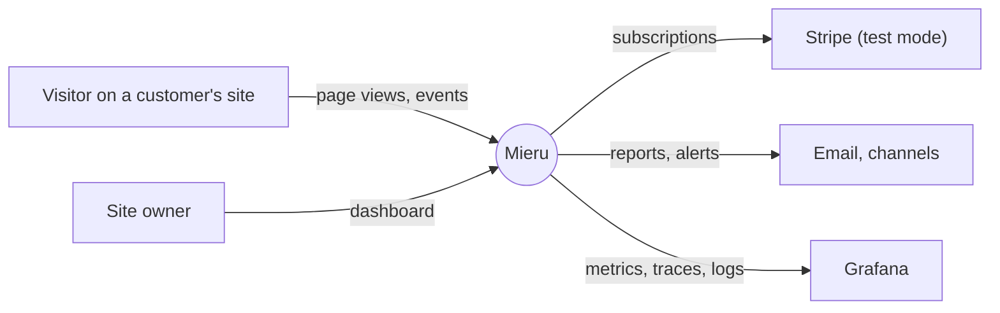
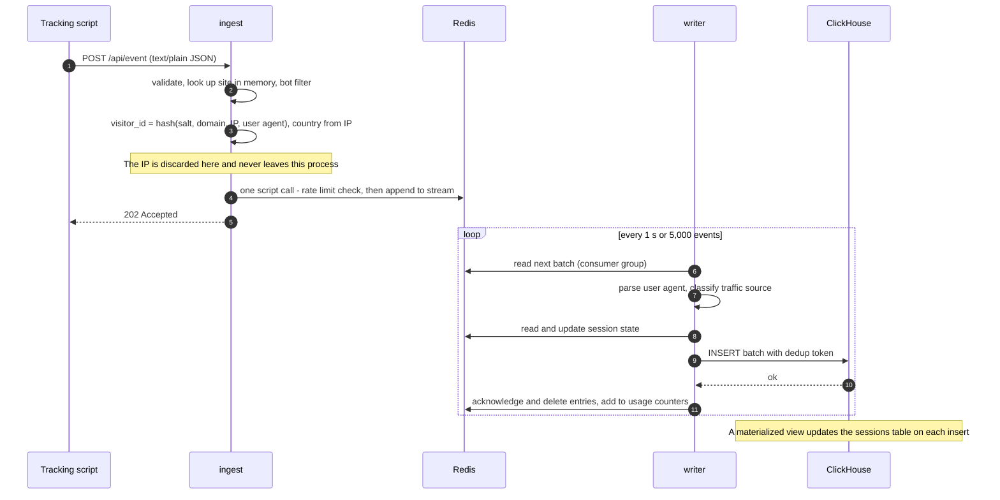
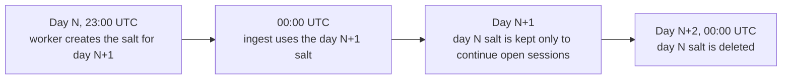
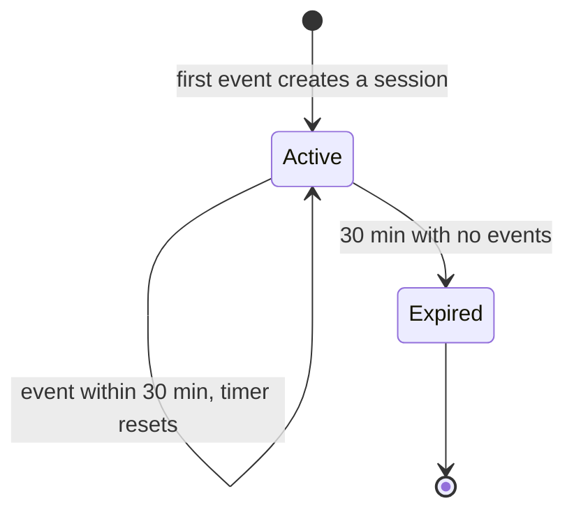
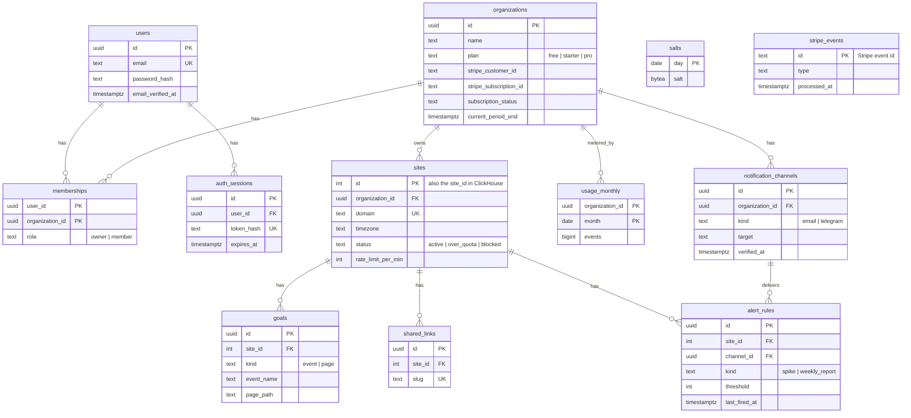
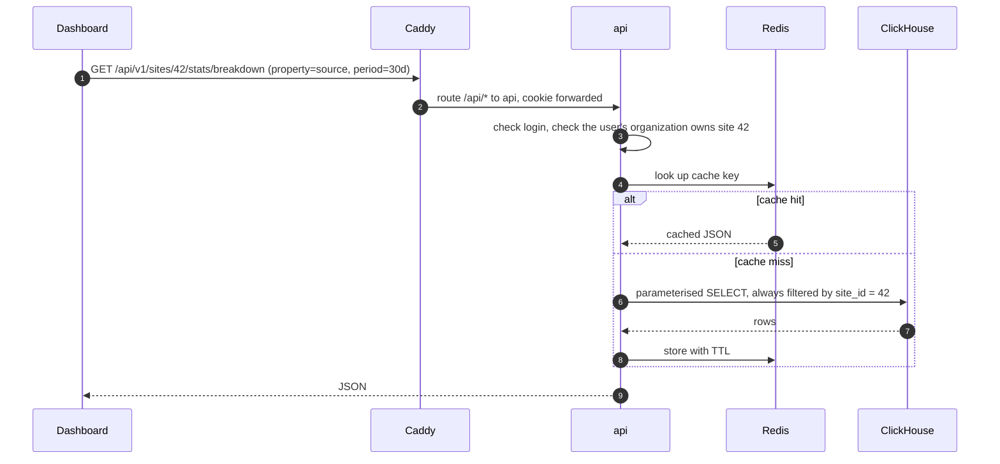
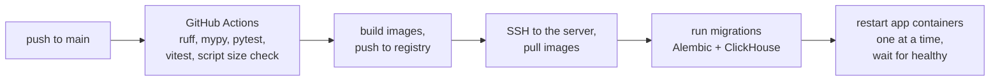

# Mieru: system design

> A privacy-first web analytics SaaS, modelled on Plausible. **FastAPI + Redis Streams + ClickHouse + Postgres + Nuxt 4**, running as one Docker Compose stack on a single VPS.
> Status: living document. Numbers marked *est.* are replaced by measurements during the build.

**How to read this:** sections 1-4 say what is being built. Sections 5-10 say how it works. Sections 11-13 cover running it and the decisions I want challenged. Numbers marked *est.* are estimates, replaced by measurements during the build.

---

## Table of contents

1. [Summary](#1-summary)
2. [Functional requirements](#2-functional-requirements)
3. [Non-functional requirements](#3-non-functional-requirements)
4. [Architecture](#4-architecture)
5. [Write path: from page view to ClickHouse](#5-write-path-from-page-view-to-clickhouse)
6. [Privacy and visitor identity](#6-privacy-and-visitor-identity)
7. [Data model](#7-data-model)
8. [Read path: dashboard queries](#8-read-path-dashboard-queries)
9. [API surface](#9-api-surface)
10. [Tracking script](#10-tracking-script)
11. [Deployment on one VPS](#11-deployment-on-one-vps)
12. [Observability and load test](#12-observability-and-load-test)
13. [Trade-offs](#13-trade-offs)

---

## 1. Summary

A site owner adds one `<script>` tag to their site. The script sends each page view and custom event to Mieru. The owner opens a dashboard and sees visitors, pages, sources, countries and devices, close to real time.



---

## 2. Functional requirements

**Tracking script**

| #   | Requirement                                                                    |
| --- | ------------------------------------------------------------------------------ |
| T1  | Send a page view on load, with URL and referrer                                |
| T2  | Send a page view on client-side navigation (History API)                       |
| T3  | `mieru('signup', {props: {plan: 'pro'}})` sends a custom event with properties |
| T4  | Do nothing in automated browsers                                               |

**Ingest**

| #   | Requirement                                                                     |
| --- | ------------------------------------------------------------------------------- |
| I1  | Accept events for registered sites only                                         |
| I2  | Drop bots, referrer spam and over-limit traffic, and count every drop by reason |
| I3  | Compute visitor id, country, device, browser, OS, traffic source and UTM tags   |
| I4  | Group events into sessions (30 minutes of inactivity ends a session)            |

**Dashboard**

| #   | Requirement                                                                                    |
| --- | ---------------------------------------------------------------------------------------------- |
| D1  | Top numbers for a date range: unique visitors, visits, page views, bounce rate, visit duration |
| D2  | Time series chart by hour or day                                                               |
| D3  | Breakdowns: sources, UTM tags, pages, entry and exit pages, countries, devices, browsers, OS   |
| D4  | Current visitors (last 5 minutes), refreshed automatically                                     |
| D5  | Goals: mark an event or a page as a goal, see conversions and conversion rate                  |
| D6  | Click any breakdown row to filter the whole dashboard                                          |
| D7  | Public shared link to a read-only dashboard                                                    |
| D8  | Comparison with the previous period, CSV export, Stats API with API keys                       |

**Accounts, plans, alerts**

| #   | Requirement                                                                               |
| --- | ----------------------------------------------------------------------------------------- |
| A1  | Sign up, verify email, log in, log out                                                    |
| A2  | An organization owns sites; add a site and get a snippet plus an "is it installed?" check |
| A3  | Plans with a monthly event quota and a site limit; usage shown in settings                |
| A4  | Upgrade and cancel through Stripe Checkout and the customer portal (test mode)            |
| A5  | Spike alert when current visitors pass a threshold; weekly report                         |
| A6  | Alerts by email and Telegram                                                              |

---

## 3. Non-functional requirements

| Concern               | Target                                                                                                                                                      |
| --------------------- | ----------------------------------------------------------------------------------------------------------------------------------------------------------- |
| **Ingest throughput** | 1,000 events/s sustained for 10 min; 3,000/s burst for 30 s                                                                                                 |
| **Ingest latency**    | p95 < 25 ms, p99 < 100 ms, measured inside `ingest`                                                                                                         |
| **Freshness**         | An event is queryable in ClickHouse within 5 s (p95). Dashboard panels may add up to 30 s of cache on top; the live counter 10 s                            |
| **Dashboard latency** | p95 < 300 ms for a 30-day range on a site with 10M events; < 1 s for 12 months                                                                              |
| **Loss**              | Zero events lost in normal operation, across deploys, and across restarts of `ingest`, `writer` or ClickHouse. At most about 1 s of events if Redis crashes |
| **Script**            | 1 KB gzipped or less, no cookies, nothing written to browser storage, one request per page view                                                             |
| **Availability**      | Ingest 99.9% per month, dashboard 99.5%                                                                                                                     |

---

## 4. Architecture

```mermaid
flowchart LR
    V["Visitor's browser<br/>tracking script"]
    O["Site owner's browser"]
    EXT["Alerts, Stripe, ..."]

	CD["server<br/>TLS, routing, retries"]
	ING["ingest service"]
	WEB["web ui"]
	API["api service"]
	WR["writer service<br/>stream consumer"]
	WK["worker<br/>taskrunner + scheduler"]
	RD[("Redis<br/>stream, sessions,<br/>cache, counters")]
	PG[("Postgres<br/>accounts, sites, billing")]
	CH[("ClickHouse<br/>events, sessions")]

    V --> CD
    O --> CD
    CD -->|"POST /api/event"| ING
    CD -->|"/api/*"| API
    CD -->|"everything else"| WEB
    ING -->|"append"| RD
    ING -.->|"refresh site and salt cache, every 30 s"| PG
    RD -->|"batches"| WR
    WR -->|"bulk insert"| CH
    API --> PG
    API -->|"stats queries"| CH
    API --> RD
    WK --> PG
    WK --> CH
    WK --> RD
    WK --> EXT
```



| Component            | Responsibility                                                                      |
| -------------------- | ----------------------------------------------------------------------------------- |
| **`web-server`**     | TLS certificates, routing by host and path, health checks                           |
| **`web ui`**         | Dashboard, public shared dashboards                                                 |
| **`ingest service`** | `POST /api/event` and the script file. Validate, gate, hash, append to the stream   |
| **`api service`**    | Auth, sites, goals, stats queries, billing, alert rules                             |
| **`writer service`** | Read stream batches, assign sessions, insert into ClickHouse, acknowledge           |
| **`worker`**         | Scheduled and slow jobs: usage metering, alert checks, reports, emails              |
| **`Redis`**          | Event buffer, session state, rate-limit and usage counters, query cache, task queue |
| **`Postgres`**       | Source of truth for everything that is not an event                                 |
| **`ClickHouse`**     | Events and sessions; all dashboard aggregation                                      |

---

## 5. Write path: from page view to ClickHouse



### 5.1 What `ingest` does per request

In order. The cheap rejections come first.

1. **Parse and validate** the body: event name up to 120 characters, URL up to 2,000, at most 30 properties, body at most 8 KB. A malformed body gets `400`.
2. **Site lookup** in an in-process dictionary keyed by domain, refreshed from Postgres every 30 s. An unknown domain costs one lookup and is then remembered as unknown for 60 s, so a flood for a fake domain stays in memory.
3. **Site status**: `blocked` and `over_quota` sites are dropped here.
4. **Bot filter**: empty or known-bot user agents, headless browsers, referrers on a spam blocklist.
5. **Visitor id**: a keyed hash over domain, IP and user agent (section 6). The IP is the one Caddy saw on the TCP connection; forwarding headers sent by the client are ignored.
6. **Country**: lookup in a local IP-to-country database held in memory (DB-IP Lite, *est.* under 10 MB). Country only; city is a stretch goal because that database is many times larger and is loaded by every ingest container.
7. **Discard the IP.**
8. **One Redis call**, a small Lua script: increment the site's rate-limit counter, refuse if over the limit, otherwise append the event to the stream. Doing both in one script keeps it to one network round trip.
9. **Answer `202`.** If the event was dropped at any step, the answer is still `202`, with an `X-Mieru-Dropped: <reason>` header, and a counter for that reason goes up.

Nothing in this list waits on Postgres or ClickHouse. If both are down, ingest keeps accepting.

### 5.2 What `writer` does per batch

1. **Read** up to 5,000 entries from the stream as a member of a consumer group. A consumer group is Redis's way of tracking which entries have been handed out and which have been acknowledged.
2. **Parse the user agent** into browser, OS and device type. Parsing is slow (many regular expressions), so results are cached by user-agent string; real traffic has few distinct strings.
3. **Classify the source**: referrer host and UTM tags become a source name ("Google", "Hacker News", "Direct").
4. **Assign the session.** Look up `sess:{site}:{visitor}` in Redis. If it exists, reuse its `session_id` and its first-touch attributes (source, UTM, country, device). If not, create one. Either way reset its 30-minute expiry. All lookups for a batch go in one pipeline.
5. **Insert** the batch into ClickHouse in one statement.
6. **Acknowledge** the entries, delete them from the stream, and add the batch's per-organization counts to the monthly usage counters.

The raw user agent sits in the stream for about a second and is not stored in ClickHouse.

### 5.3 Buffering and backpressure

The stream is the shock absorber between a spiky input and a database that wants steady batches.

- **Normal:** the stream holds under a second of events.
- **ClickHouse slow or down:** the writer retries its batch with backoff. Entries pile up in Redis. At the expected load the 200,000-entry limit is hours of buffer; at the peak test rate it is about three minutes.
- **Stream over the limit:** `ingest` checks the stream length once a second and, above the high-water mark, drops new events with reason `backpressure`. This is deliberate: an explicit, counted drop at the door instead of Redis running out of memory or silently trimming unprocessed entries.
- **Redis unreachable:** `ingest` holds up to 10,000 events in a bounded in-process queue and retries. When that is full it drops and counts.

### 5.4 Delivery guarantees

The pipeline is **at-least-once**: an entry is deleted from the stream only after ClickHouse confirms the insert. The one failure that causes a repeat is "insert succeeded, acknowledgement did not" (the writer crashes in between).

Planned fix, to be proven by a test during the build: the writer re-reads its unacknowledged entries on restart, which reproduces the same batch, and sends it with an `insert_deduplication_token` derived from the first and last stream ids. ClickHouse then ignores a batch it has already stored. Session assignment is safe to repeat because the Redis session record holds only the id, the start time and first-touch attributes, no counters.

Without the token the fallback is to accept rare duplicates, which is what most analytics pipelines do.

---

## 6. Privacy and visitor identity

**The problem:** "unique visitors" needs some notion of the same person, and the usual answer is a cookie. Mieru uses none.

**The recipe** (Plausible's approach):

```text
visitor_id = BLAKE2b( key = salt_of_the_day,
                      data = site_domain | ip_address | user_agent )  -> 64-bit integer
```

- The **salt** is 16 random bytes, different for each UTC day.
- The same person on the same site on the same day gets the same id, so page views can be grouped into visits and counted as one visitor.
- The **domain** is in the hash, so the same person on two customer sites gets two unrelated ids. No cross-site tracking is possible.
- When a salt is deleted, nobody (including me) can recompute or reverse the ids made with it.

**Salt lifecycle**



Each salt row is stored with the date it belongs to, and `ingest` picks the salt by the event's UTC date. Creating tomorrow's salt an hour early removes any race at midnight.

**Sessions across midnight.** At 00:00 the visitor's id changes. To avoid cutting every open session in two, `ingest` also computes the id under yesterday's salt and sends both. The writer looks for a live session under today's id, then yesterday's.



**What is stored where**

| Data | `ingest` memory | Redis | ClickHouse | Logs |
|---|---|---|---|---|
| IP address | For one request | Never | Never | Never |
| User agent string | For one request | About 1 s (in the stream) | Never (only browser, OS, device) | Never |
| Visitor id (daily hash) | Yes | 30 min (session key) | Yes | Never |
| Country | Yes | Yes | Yes | Never |

**Known limits, accepted**

- The same person on two days counts as two visitors, so a 30-day "unique visitors" number is really "sum of daily uniques for returning visitors". Plausible has the same limit and documents it.
- Two devices are two visitors.
- People behind one office network with identical browsers merge into one visitor.
- Anyone can post fake events for any domain. This is true of all script-based analytics. Rate limits and bot filters bound the damage.
- The only hop in front of `ingest` is my own Caddy, with access logging off for the ingest domain. DNS is at Cloudflare in DNS-only mode, so Cloudflare never sees a request. The hosting provider can see network metadata, as with any host.

---

## 7. Data model

### 7.1 Postgres (everything that is not an event)



Decisions worth noting:

1. **Every user gets a personal organization at signup**, and sites belong to the organization. Adding team members later is then a row in `memberships`, not a migration.
2. **`sites.id` is a plain integer**, unlike the other keys. It is repeated on every event row in ClickHouse, where a 4-byte integer sorts and compresses far better than a UUID.
3. **`stripe_events` exists only for idempotency.** Stripe may deliver a webhook more than once; the unique event id makes the second delivery a no-op.

### 7.2 ClickHouse (events)

ClickHouse stores each column separately and keeps rows sorted by the table's `ORDER BY` key. A query that filters on the first key columns reads only the matching slice of only the columns it names. That is why "top pages for site 42 in October" is fast even with hundreds of millions of rows in the table.

Sketch (final types are settled during the build):

```sql
CREATE TABLE events
(
    site_id        UInt32,
    timestamp      DateTime CODEC(Delta, ZSTD),
    name           LowCardinality(String),      -- 'pageview' or a custom event name
    visitor_id     UInt64,                      -- daily rotating hash
    session_id     UInt64,
    session_start  DateTime,                    -- identical on every event of a session
    hostname       LowCardinality(String),
    pathname       String CODEC(ZSTD(3)),
    -- session attributes, copied onto every event by the writer
    source         LowCardinality(String),      -- 'Google', 'Direct', ...
    referrer       String CODEC(ZSTD(3)),
    utm_source     LowCardinality(String),
    utm_medium     LowCardinality(String),
    utm_campaign   LowCardinality(String),
    country        LowCardinality(FixedString(2)),
    device         LowCardinality(String),      -- desktop | mobile | tablet
    browser        LowCardinality(String),
    os             LowCardinality(String),
    props          Map(LowCardinality(String), String)
)
ENGINE = MergeTree
PARTITION BY toYYYYMM(timestamp)
ORDER BY (site_id, toDate(timestamp), name, visitor_id, timestamp);
```

- **`ORDER BY (site_id, date, ...)`** matches the filter every dashboard query has. It also puts one site's rows next to each other, which is what makes compression good.
- **`LowCardinality`** stores a column with few distinct values (browser, country) as small integers plus a dictionary.
- **Monthly partitions** make dropping old data a cheap metadata operation.
- **Session attributes on every row** trade disk (cheap, and repeated values compress to almost nothing) for never needing a join.

**Sessions** are derived, not written by the application:

```sql
CREATE TABLE sessions
(
    site_id        UInt32,
    session_start  DateTime,
    session_id     UInt64,
    visitor_id     SimpleAggregateFunction(any, UInt64),
    last_seen      SimpleAggregateFunction(max, DateTime),
    pageviews      SimpleAggregateFunction(sum, UInt64),
    events         SimpleAggregateFunction(sum, UInt64),
    entry_page     AggregateFunction(argMin, String, DateTime),
    exit_page      AggregateFunction(argMax, String, DateTime)
    -- plus source, utm_*, country, device, browser, os as "any" columns
)
ENGINE = AggregatingMergeTree
PARTITION BY toYYYYMM(session_start)
ORDER BY (site_id, session_start, session_id);

CREATE MATERIALIZED VIEW sessions_mv TO sessions AS
SELECT site_id, session_start, session_id,
       any(visitor_id)                 AS visitor_id,
       max(timestamp)                  AS last_seen,
       countIf(name = 'pageview')      AS pageviews,
       count()                         AS events,
       argMinStateIf(pathname, timestamp, name = 'pageview') AS entry_page,
       argMaxStateIf(pathname, timestamp, name = 'pageview') AS exit_page
FROM events
GROUP BY site_id, session_start, session_id;
```

A materialized view in ClickHouse is an insert trigger: each batch inserted into `events` is aggregated and the result is written to `sessions`. `AggregatingMergeTree` then merges rows with the same key in the background. A session that receives events in five different batches has up to five partial rows until they merge, so every read groups by `session_id` to combine them:

```sql
SELECT count()                               AS visits,
       countIf(pv = 1) / count()             AS bounce_rate,
       avg(last - session_start)             AS avg_duration_s
FROM (
    SELECT session_id, session_start, sum(pageviews) AS pv, max(last_seen) AS last
    FROM sessions
    WHERE site_id = 42 AND session_start >= '2026-10-01' AND session_start < '2026-11-01'
    GROUP BY session_id, session_start
);
```

`session_start` is carried on every event so that all partial rows of one session share the same sort key and partition. Without it, the sessions table could not be filtered by date.

### 7.3 Redis keys

| Key | Type | Purpose | Lifetime |
|---|---|---|---|
| `events` | Stream + one consumer group | Buffer between `ingest` and `writer` | Entry deleted after acknowledgement |
| `sess:{site_id}:{visitor_id}` | Hash | Session id, start, first-touch attributes | 30 min, reset on each event |
| `rl:{site_id}:{minute}` | Counter | Per-site rate limit | 2 min |
| `usage:{org_id}:{yyyymm}` | Counter | Events accepted this month | 60 days |
| `cache:stats:{hash}` | String | Cached query result | 30 s or 24 h |
| `alert:cooldown:{rule_id}` | Flag | Stops a rule firing repeatedly | 1 h |
| Taskiq keys | Lists | Background job queue | Until processed |

Everything in Redis except the stream can be lost and rebuilt: sessions restart, counters are re-derived from ClickHouse, the cache refills.

---

## 8. Read path: dashboard queries



**One dashboard load is about eight queries** (top numbers, chart, six breakdowns), sent in parallel. Each is a single aggregate over one site's slice of `events` or `sessions`:

```sql
SELECT source, uniq(visitor_id) AS visitors
FROM events
WHERE site_id = 42
  AND timestamp >= '2026-10-01' AND timestamp < '2026-11-01'
  AND name = 'pageview'
GROUP BY source
ORDER BY visitors DESC
LIMIT 10;
```

**Query builder.** The API never accepts SQL or column names from the client. Metrics, dimensions and filters come from fixed lists and are turned into parameterised queries. `site_id` is added by the server after the membership check; this is the tenant boundary in ClickHouse.

**Caching**

| Range | TTL | Reason |
|---|---|---|
| Includes today | 30 s | Data is still arriving |
| Entirely in the past | 24 h | The data cannot change |
| Current visitors | 10 s | Shown as "live"; the dashboard polls every 30 s |

The cache key is a hash of site, metric, range and filters. The site's timezone is applied at query time.

**Guard rails for a 2 GB ClickHouse:** every query runs with a time limit (10 s), a memory limit and a low thread count, so one expensive query cannot starve inserts.

**Rollups: measure first.** Raw queries with the right sort key are expected to meet the 300 ms target at this scale. If the load test says otherwise, the next step is an hourly rollup table fed by a second materialized view. One detail matters there: **unique counts cannot be added up.** A visitor seen at 10:00 and at 11:00 is one visitor, not two, so an hourly table must store a mergeable sketch (`uniqState`) rather than a number, and the query merges sketches across hours. Page views, by contrast, are plain sums.

---

## 9. API surface

**Ingest** (public, on its own domain)

| Method | Path | Notes |
|---|---|---|
| POST | `/api/event` | Body below. `202` when well formed, `400` when not. `Access-Control-Allow-Origin: *`. Never sets a cookie |
| GET | `/js/p.js` | The tracking script, cached for a day |
| GET | `/health` | Liveness, checks Redis |

```json
{ "n": "pageview", "d": "example.com", "u": "https://example.com/pricing?utm_source=hn",
  "r": "https://news.ycombinator.com/", "p": { "plan": "pro" } }
```

`n` name, `d` site domain, `u` full URL, `r` referrer, `p` optional properties. The timestamp is set by the server; client clocks are not trusted.

**Dashboard API** (same origin as the dashboard: Caddy routes `mieru.example/api/v1/...` to `api`)

| Area | Endpoints |
|---|---|
| Auth | `POST /auth/register`, `/auth/login`, `/auth/logout`, `/auth/verify-email`; `GET /me` |
| Sites | `GET/POST /sites`, `GET/PATCH/DELETE /sites/{id}`, `GET /sites/{id}/verify` (has any event arrived?) |
| Stats | `GET /sites/{id}/stats/aggregate`, `/timeseries`, `/breakdown`, `/realtime`. Common parameters: `period` or `from`/`to`, `metrics`, `property`, `filters`, `limit` |
| Goals | `GET/POST /sites/{id}/goals`, `DELETE /goals/{id}` |
| Sharing | `POST /sites/{id}/shared-links`; `GET /share/{slug}/stats/...` (no login, read-only) |
| Billing | `GET /billing/usage`, `POST /billing/checkout`, `POST /billing/portal`, `POST /billing/webhook` |
| Alerts | `GET/POST /sites/{id}/alerts`, `GET/POST /channels`, `POST /channels/{id}/verify` |

**Conventions:** JSON; one error shape `{"error": {"code", "message"}}`; a site the user cannot access returns `404`, not `403`, so ids cannot be probed.

**Auth model.** Login creates a random session token, sets it in an `HttpOnly; Secure; SameSite=Lax` cookie, and stores only its hash in Postgres. Each request looks the hash up (cached in Redis for 60 s). Logout or password change deletes the row, which revokes the session immediately. Passwords are hashed with argon2. Because Caddy serves the dashboard and its API from one origin, there is no CORS configuration on the dashboard API at all.

---

## 10. Tracking script

```html
<script defer data-domain="example.com" src="https://in.mieru.example/js/p.js"></script>
```

| Aspect                    | Design                                                                                                                                                 |
| ------------------------- | ------------------------------------------------------------------------------------------------------------------------------------------------------ |
| **Size budget**           | 1 KB gzipped or less, enforced in CI. For reference: Plausible's old base script is 1.3 KB, its current one about 2.5 KB, Google Analytics over 100 KB |
| **Transport**             | `fetch(url, {method: 'POST', keepalive: true, headers: {'Content-Type': 'text/plain'}})`. `keepalive` lets the request finish while the page unloads   |
| **Page views**            | One on load. For single-page apps, wrap `history.pushState` and listen for `popstate`; skip if the path did not change                                 |
| **Custom events**         | `window.mieru(name, {props})`. Calls made before the script loads are queued                                                                           |
| **Refuses to track**      | `file:` pages, automated browsers (`navigator.webdriver`), and browsers where the owner set an opt-out flag in local storage (read, never written)     |
| **Stores in the browser** | Nothing                                                                                                                                                |
| **Built with**            | Plain JavaScript, minified with terser; no framework, no dependencies                                                                                  |

Left out of the base script to keep the size: outbound links, file downloads, scroll depth, form tracking. Ad blockers block known analytics domains; a guide for proxying the script through the customer's own domain is a stretch item.

---
## 11. Deployment on one VPS

Everything runs as one Docker Compose project on a single Linux server in the EU. The first draft of this design used Railway; trade-off 17 explains the switch.

**The server**

| | |
|---|---|
| **Size** | 4 shared vCPU, 8 GB RAM, 80 GB local SSD, Ubuntu LTS |
| **Reference offer** | Hetzner CX33 in Germany or Finland: 8.49 EUR/month on Hetzner's price list of 15 June 2026 |
| **Why Hetzner** | EU company and data centres, hourly billing (useful for load tests), a firewall and backups from the provider |

> ⚠️ **Availability risk.** In October 2026 Hetzner's site marks its cost-optimized line, which CX33 belongs to, as "currently not available". The same size on the next line up (CPX32) is 35.49 EUR/month. Nothing in this design is specific to Hetzner: any EU server of this size under 15 EUR/month will do. The first task of the build is to check what can actually be ordered.

**Containers**

| Container | Image | Networks | Open to the internet | Restarted by an app deploy |
|---|---|---|---|---|
| `caddy` | caddy | edge | ports 80, 443 | Only when its config changes |
| `web` | mieru-web | edge | no | Yes |
| `ingest-1`, `ingest-2` | mieru-app | edge, internal | no | Yes, one at a time |
| `api` | mieru-app | edge, internal | no | Yes |
| `writer`, `worker` | mieru-app | internal | no | Yes |
| `postgres`, `redis`, `clickhouse` | official images | internal | no | No |
| `alloy` | grafana/alloy | internal | no | No |

**Routing (Caddy)**

| Request | Goes to |
|---|---|
| `in.mieru.example/*` | `ingest-1` and `ingest-2`, health-checked. A request that fails on one is retried on the other for up to 5 s |
| `mieru.example/api/*` | `api` |
| `mieru.example/*` | `web` |

Caddy obtains and renews Let's Encrypt certificates on its own.

**Network and access**

- Databases sit on the `internal` Compose network and have no published ports.
- The provider's firewall, outside the server, allows only 22, 80 and 443. This matters because Docker writes its own packet-filter rules and bypasses a host firewall such as `ufw` for published ports.
- SSH with keys only; no root login, no passwords.
- Cloudflare hosts DNS in DNS-only mode (trade-off 21).
- Secrets live in an `.env` file on the server, readable only by the deploy user, never in the repository. CI holds one SSH deploy key and a registry token.

**Deploy pipeline**



- **No lost events during a deploy.** The script restarts `ingest-1`, waits for its health check, then restarts `ingest-2`. Caddy keeps sending traffic to whichever is healthy.
- **Clean shutdown.** On SIGTERM `ingest` finishes in-flight requests and `writer` finishes and acknowledges its current batch.
- **Failed migration** stops the deploy before any container restarts. Schema changes follow expand, migrate, contract so old and new code can overlap.
- **Rollback** is a deploy of the previous image; images are tagged with the git commit.
- **Database containers are not touched** by an app deploy.

**Backups and restore**

| What | How | Kept | Off the server |
|---|---|---|---|
| Whole disk | Provider backup, daily | 7 days | No (same provider) |
| Postgres | `pg_dump` nightly to Cloudflare R2 | 30 days | Yes |
| ClickHouse | `BACKUP` to R2, weekly | 4 weeks | Yes |
| Server setup | Bootstrap script and Compose file in the repo | git history | Yes |

R2's free tier covers 10 GB. Before launch, one restore drill: new server, bootstrap script, restore both databases, switch DNS. Target: under an hour.

**Keeping the server healthy:** automatic security updates, a size cap on container logs, a memory limit per container, containers set to start on boot, and a disk alert at 70%.

**Local development:** the same Compose file with a dev override. Postgres, Redis and ClickHouse run in Docker; the Python services and Nuxt run natively with reload.

**What this gives up compared with a platform like Railway:** a preview environment per pull request, managed TLS and deploys, and any protection against the server itself failing.

---

## 12. Observability and load test

Mieru is itself a monitoring product, so its own pipeline has to be visible. Each service sends metrics, traces and structured logs over OpenTelemetry to a Grafana Alloy container, which forwards them to Grafana Cloud's free tier together with container logs and host metrics.

**The numbers that say whether the pipeline is healthy**

| Metric | Where | Alert when |
|---|---|---|
| Ingest requests/s and latency (p50, p95, p99) | `ingest` | p99 > 100 ms for 5 min |
| Events dropped, by reason | `ingest` | Drops > 1% of accepted (excluding bots) |
| **Stream length and age of the oldest entry** | `writer` | Oldest entry > 30 s |
| Batch size, insert duration, insert failures | `writer` | Any failure streak > 1 min |
| ClickHouse query duration by query type | `api` | p95 > 1 s |
| Cache hit ratio | `api` | Informational |
| ClickHouse active parts, memory, disk used | ClickHouse | Disk > 70% |
| Job failures | `worker` | Any |
| Host CPU, memory and disk; memory per container | `alloy` | Disk > 70%, memory > 90% |

Stream age is the single best signal: if it grows, the writer or ClickHouse is behind, whatever the cause.

**Load test (k6)**

k6 runs on a second server rented by the hour in the same data centre, so the load generator does not take CPU from the system under test. It targets the public domain, so TLS and Caddy are part of the measurement. The vCPUs are shared with other customers, so each scenario runs three times and the median is reported.

All k6 traffic comes from one IP, which would make every request the same visitor. A header accepted only with a load-test secret lets k6 supply a visitor seed, so the test produces a realistic number of sessions.

| # | Scenario | Passes when |
|---|---|---|
| 1 | Ramp to 1,000 events/s, hold 10 min | p99 < 100 ms, stream age < 5 s, ClickHouse row count = events sent |
| 2 | Burst to 3,000 events/s for 30 s | No errors; stream drains within 60 s |
| 3 | One site at 5x its rate limit, others normal | Other sites' latency unchanged; excess counted as `rate_limited` |
| 4 | Kill `writer` during scenario 1 | No loss, no duplicates, lag recovers after restart |
| 5 | Restart ClickHouse during scenario 1 | No loss; ingest latency unaffected |
| 6 | 20 dashboard users on a 10M-event site during scenario 1 | Dashboard p95 < 300 ms |
| 7 | Deploy a new version during scenario 1 | No loss, no failed requests seen by k6 |

Output: a results table and the bottlenecks found, in the README. The headline is "N events/s on one 4 vCPU / 8 GB server at about 11 EUR/month", with proxy, application, Redis and ClickHouse all sharing that server.

---
## 13. Trade-offs

| #   | Decision                 | Chosen                                                           | Main alternative                                                                      | Why                                                                                                                                                                                                                                                                                                                      |
| --- | ------------------------ | ---------------------------------------------------------------- | ------------------------------------------------------------------------------------- | ------------------------------------------------------------------------------------------------------------------------------------------------------------------------------------------------------------------------------------------------------------------------------------------------------------------------ |
| 1   | Event store              | ClickHouse                                                       | Postgres with partitions and rollup tables; TimescaleDB                               | Columnar storage fits "aggregate a few columns over many rows". Postgres is cheaper to run but needs hand-built rollups for every breakdown. Cost: a third of the server's memory and one more system to operate                                                                                                           |
| 2   | Buffer                   | Redis Stream                                                     | In-process buffer (Plausible); ClickHouse async inserts; Kafka or Redpanda            | Survives deploys, shared by all ingest containers, absorbs ClickHouse downtime. Kafka is the textbook answer but is heavy to operate for 20 events a second. Async inserts would remove the buffer but not the need for a place to enrich and assign sessions                                                      |
| 3   | Ingest vs API            | Two services, one codebase                                       | One FastAPI app                                                                       | Collection stays up when the dashboard breaks; scale and test them separately                                                                                                                                                                                                                                            |
| 4   | Where enrichment happens | Hash and country in `ingest`, the rest in `writer`               | Everything in `ingest`; everything in `writer`                                        | The IP must not leave `ingest`, so anything needing it happens there. Slow work (user agent parsing, sessions) stays off the request path                                                                                                                                                                                |
| 5   | Sessions                 | Materialized view into `AggregatingMergeTree`                    | Cancel-row updates (`VersionedCollapsingMergeTree`, Plausible); compute at query time | Append-only and replayable. Cost: reads must group by session id                                                                                                                                                                                                                                                         |
| 6   | Visitor identity         | Daily salted hash                                                | First-party cookie; no uniques at all (Simple Analytics)                              | No consent banner and still a usable "unique visitors". Cost: multi-day uniques are overcounted                                                                                                                                                                                                                          |
| 7   | Delivery                 | At-least-once + dedup token                                      | At-most-once (acknowledge before insert)                                              | Losing data is worse than rare duplicates; the token removes most duplicates                                                                                                                                                                                                                                             |
| 8   | Overload behaviour       | Counted drops at a high-water mark                               | Let Redis trim the stream; return 503                                                 | The script cannot usefully retry, and an error on the customer's page helps nobody. Explicit drops are visible in metrics                                                                                                                                                                                                |
| 9   | Rollups                  | Raw queries first, rollups if measured                           | Hourly rollups from day one                                                           | Avoids building and maintaining tables the scale may never need. The load test decides                                                                                                                                                                                                                                   |
| 10  | Realtime                 | Polling every 30 s                                               | WebSocket or SSE push                                                                 | "Current visitors" changes slowly; polling is stateless and cacheable                                                                                                                                                                                                                                                    |
| 11  | Frontend                 | Nuxt 4 SSR, on the same origin as the API (Caddy routes by path) | SPA calling the API on another origin                                                 | No CORS, first-party cookies, SSR for the public pages. Cost: a second frontend framework                                                                                                                                                                                                                                               |
| 12  | Auth                     | Server-side sessions, opaque cookie                              | JWT access + refresh tokens                                                           | Instant revocation and less machinery. Cost: one cached lookup per request                                                                                                                                                                                                                                               |
| 13  | Task queue               | Taskiq                                                           | ARQ; Celery                                                                           | Async-native, has a scheduler, actively developed. ARQ is simpler but in maintenance mode. Celery is the industry default but sync-first and heavier                                                                                                                                                                     |
| 14  | Geo lookup               | Local country database in memory                                 | City-level database; Cloudflare's country header                                      | No third party sees the IP, and little RAM. City needs many times the memory                                                                                                                                                                                                                                             |
| 15  | Custom properties        | `Map(String, String)` column                                     | Two parallel arrays (Plausible); JSON column                                          | Simplest to query (`props['plan']`); good enough at this scale                                                                                                                                                                                                                                                           |
| 16  | Tenancy in ClickHouse    | Shared tables, `site_id` first in the sort key                   | Table or database per customer                                                        | One schema to migrate; the sort key already isolates each site's data on disk                                                                                                                                                                                                                                            |
| 17  | Hosting                  | One VPS with Docker Compose                                      | Railway (the first draft of this design); Fly.io; Render                              | On Railway this stack came to about $22/month with ClickHouse's RAM as 40% of it, volumes were capped at 5 GB, and the benchmark would have included Railway's own proxy. The VPS is about half the price with over four times the memory. Cost: I own TLS, deploys, backups and patching, and lose preview environments |
| 18  | Payments                 | Stripe Checkout + webhooks                                       | Own payment form                                                                      | No card data in Mieru; webhook handling is the transferable skill                                                                                                                                                                                                                                                        |
| 19  | Reverse proxy            | Caddy                                                            | nginx + certbot; Traefik                                                              | Automatic TLS and a config of about fifteen lines. nginx is the more common one in production, so worth knowing as well                                                                                                                                                                                                  |
| 20  | Deploy tooling           | Compose + a short deploy script                                  | Kamal; Coolify or Dokploy; Docker Swarm; Kubernetes                                   | Every step is explicit and auditable. Kamal and Swarm do rolling deploys out of the box and are the next step if the script grows                                                                                                                                                                                     |
| 21  | Cloudflare               | DNS only                                                         | Proxied mode (CDN, DDoS protection, hides the server's address)                       | In proxied mode a third party sees every visitor's IP, which weakens the privacy claim, and its protections can interfere with a load test. Cost: the server's address is public and the script has no CDN                                                                                                               |
| 22  | Backups                  | Provider disk backups + database dumps to R2                     | Provider backups only                                                                 | Disk backups alone sit with the same provider and capture databases mid-write                                                                                                                                                                                                                                            |

---

## Sources

- Plausible data policy and docs: <https://plausible.io/data-policy>, <https://plausible.io/docs>
- Plausible source code (ingestion pipeline, write buffer, session cache, ClickHouse migrations, tracker): <https://github.com/plausible/analytics>
- Hetzner price list of 15 June 2026: <https://docs.hetzner.com/general/infrastructure-and-availability/price-adjustment/>
- Cloudflare R2 pricing: <https://developers.cloudflare.com/r2/pricing/>
- Railway pricing, for the comparison in trade-off 17: <https://docs.railway.com/pricing/plans>

