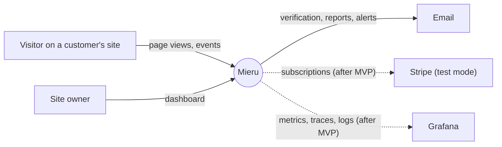
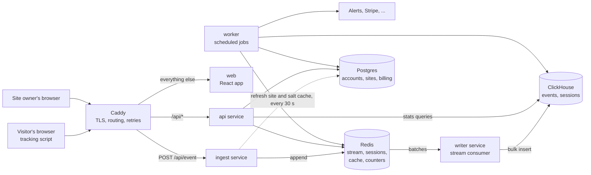

# Mieru: system design

> A privacy-first web analytics SaaS, modelled on Plausible. **FastAPI + Redis Streams + ClickHouse + Postgres + React**, running as one Docker Compose stack on a single VPS behind Caddy.
> Status: living document. Numbers marked *est.* are estimates, replaced by measurements during the build.

**How to read this:** this file says what is being built: the summary, the requirements and the components. Each part of how it works has its own file (table below), so a task reads only the files its spec names.

**Scope:** this design describes the full product. Parts marked *(after MVP)* are designed here but built after the MVP. The MVP is the core loop: tracking script, ingest, writer, ClickHouse, dashboard, accounts and sites, deployed. Who it is for and the acceptance criteria are in [product.md](../product.md). The frontend is designed in [frontend.md](../frontend.md). The build order is in [roadmap.md](../roadmap.md).

| File | What it covers |
|---|---|
| [write-path.md](write-path.md) | From page view to ClickHouse: what `ingest` and `writer` do, buffering and backpressure, delivery guarantees |
| [privacy.md](privacy.md) | Visitor identity without cookies: the daily salted hash, salt lifecycle, what is stored where |
| [data-model.md](data-model.md) | Postgres tables, the ClickHouse `events` and `sessions` tables, Redis keys |
| [read-path.md](read-path.md) | Dashboard queries, the query builder, caching, rollups |
| [api.md](api.md) | Ingest and dashboard endpoints, conventions, the auth model |
| [tracker.md](tracker.md) | The tracking script |
| [deployment.md](deployment.md) | The server, containers, Caddy, network, deploy pipeline, backups |
| [observability.md](observability.md) | Logs, health, metrics and the load test |
| [decisions.md](decisions.md) | Every design decision with its alternative and reason, numbered |

**Keeping it readable:** each file stays under about 250 lines and describes design: what and why. Step-by-step how-to (commands, server setup, config details) goes to `ops/README.md` or to comments in the config itself.

---

## Summary

A site owner adds one `<script>` tag to their site. The script sends each page view and custom event to Mieru. The owner opens a dashboard and sees visitors, pages, sources, countries and devices, close to real time.

---

## Functional requirements

**Tracking script**

| #   | Requirement                                                                    |
| --- | ------------------------------------------------------------------------------ |
| T1  | Send a page view on load, with URL and referrer                                |
| T2  | Send a page view on client-side navigation (History API)                       |
| T3  | `mieru('signup', {props: {plan: 'pro'}})` sends a custom event with properties |
| T4  | Do nothing in automated browsers                                               |

**Ingest**

| #   | Requirement                                                                     |
| --- | ------------------------------------------------------------------------------- |
| I1  | Accept events for registered sites only                                         |
| I2  | Drop bots, referrer spam and over-limit traffic, and count every drop by reason |
| I3  | Compute visitor id, country, device, browser, OS, traffic source and UTM tags   |
| I4  | Group events into sessions (30 minutes of inactivity ends a session)            |

**Dashboard**

| #   | Requirement                                                                                    |
| --- | ---------------------------------------------------------------------------------------------- |
| D1  | Top numbers for a date range: unique visitors, visits, page views, bounce rate, visit duration |
| D2  | Time series chart by hour or day                                                               |
| D3  | Breakdowns: sources, UTM tags, pages, entry and exit pages, countries, devices, browsers, OS   |
| D4  | Current visitors (last 5 minutes), refreshed automatically                                     |
| D5  | *(after MVP)* Goals: mark an event or a page as a goal, see conversions and conversion rate    |
| D6  | Click any breakdown row to filter the whole dashboard                                          |
| D7  | *(after MVP)* Public shared link to a read-only dashboard                                      |
| D8  | *(after MVP)* Comparison with the previous period, CSV export, Stats API with API keys         |

**Accounts, plans, alerts**

| #   | Requirement                                                                               |
| --- | ----------------------------------------------------------------------------------------- |
| A1  | Sign up, verify email, log in, log out                                                    |
| A2  | An organization owns sites; add a site and get a snippet plus an "is it installed?" check |
| A3  | *(after MVP)* Plans with a monthly event quota and a site limit; usage shown in settings  |
| A4  | *(after MVP)* Upgrade and cancel through Stripe Checkout and the customer portal (test mode) |
| A5  | *(after MVP)* Spike alert when current visitors pass a threshold; weekly report           |
| A6  | *(after MVP)* Alerts by email, to verified addresses                                      |

---

## Non-functional requirements

| Concern               | Target                                                                                                                                                      |
| --------------------- | ----------------------------------------------------------------------------------------------------------------------------------------------------------- |
| **Ingest throughput** | 1,000 events/s sustained for 10 min; 3,000/s burst for 30 s                                                                                                 |
| **Ingest latency**    | p95 < 25 ms, p99 < 100 ms, measured inside `ingest`                                                                                                         |
| **Freshness**         | An event is queryable in ClickHouse within 5 s (p95). Dashboard panels may add up to 30 s of cache on top; the live counter 10 s                            |
| **Dashboard latency** | p95 < 300 ms for a 30-day range on a site with 10M events; < 1 s for 12 months                                                                              |
| **Loss**              | Zero events lost in normal operation, across deploys, and across restarts of `ingest`, `writer` or ClickHouse. At most about 1 s of events if Redis crashes |
| **Script**            | 1 KB gzipped or less, no cookies, nothing written to browser storage, one request per page view                                                             |
| **Availability**      | Ingest 99.9% per month, dashboard 99.5%                                                                                                                     |

---

## Components

| Component            | Responsibility                                                                      |
| -------------------- | ----------------------------------------------------------------------------------- |
| **`caddy`**          | TLS (automatic Let's Encrypt certificates), routing by host and path, health checks and retries across the ingest replicas, the web app's static files |
| **`web`**            | React dashboard (and, after MVP, public shared dashboards). Rendering mode, libraries and structure: [frontend.md](../frontend.md) |
| **`ingest service`** | `POST /api/event` and the script file. Validate, gate, hash, append to the stream   |
| **`api service`**    | Auth, sites, stats queries; after MVP also goals, billing, alert rules              |
| **`writer service`** | Read stream batches, assign sessions, insert into ClickHouse, acknowledge           |
| **`worker`**         | Scheduled jobs. MVP: daily salt rotation. After MVP: usage metering, alert checks, reports, emails |
| **`Redis`**          | Event buffer, session state, rate-limit counters, query cache; after MVP usage counters and the task queue |
| **`Postgres`**       | Source of truth for everything that is not an event                                 |
| **`ClickHouse`**     | Events and sessions; all dashboard aggregation                                      |

---

## Sources

- Plausible data policy and docs: <https://plausible.io/data-policy>, <https://plausible.io/docs>
- Plausible source code (ingestion pipeline, write buffer, session cache, ClickHouse migrations, tracker): <https://github.com/plausible/analytics>
- Hetzner price list of 15 June 2026: <https://docs.hetzner.com/general/infrastructure-and-availability/price-adjustment/>
- Cloudflare R2 pricing: <https://developers.cloudflare.com/r2/pricing/>
- Railway pricing, for the comparison in [decision 17](decisions.md): <https://docs.railway.com/pricing/plans>
