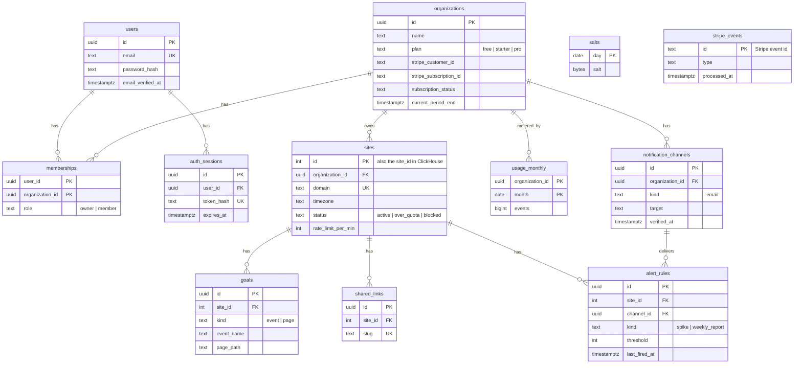

# Data model

> Part of the [system design](README.md).

## Postgres (everything that is not an event)



**MVP tables:** `users`, `organizations`, `memberships`, `auth_sessions`, `sites`, `salts`. The others are created with their features after the MVP.

Decisions worth noting:

1. **Every user gets a personal organization at signup**, and sites belong to the organization. Adding team members later is then a row in `memberships`, not a migration.
2. **`sites.id` is a plain integer**, unlike the other keys. It is repeated on every event row in ClickHouse, where a 4-byte integer sorts and compresses far better than a UUID.
3. **`stripe_events` exists only for idempotency.** Stripe may deliver a webhook more than once; the unique event id makes the second delivery a no-op.

## ClickHouse (events)

ClickHouse stores each column separately and keeps rows sorted by the table's `ORDER BY` key. A query that filters on the first key columns reads only the matching slice of only the columns it names. That is why "top pages for site 42 in October" is fast even with hundreds of millions of rows in the table.

Sketch (final types are settled during the build):

```sql
CREATE TABLE events
(
    site_id        UInt32,
    timestamp      DateTime CODEC(Delta, ZSTD),
    name           LowCardinality(String),      -- 'pageview' or a custom event name
    visitor_id     UInt64,                      -- daily rotating hash
    session_id     UInt64,
    session_start  DateTime,                    -- identical on every event of a session
    hostname       LowCardinality(String),
    pathname       String CODEC(ZSTD(3)),
    -- session attributes, copied onto every event by the writer
    source         LowCardinality(String),      -- 'Google', 'Direct', ...
    referrer       String CODEC(ZSTD(3)),
    utm_source     LowCardinality(String),
    utm_medium     LowCardinality(String),
    utm_campaign   LowCardinality(String),
    country        LowCardinality(FixedString(2)),
    device         LowCardinality(String),      -- desktop | mobile | tablet
    browser        LowCardinality(String),
    os             LowCardinality(String),
    props          Map(LowCardinality(String), String)
)
ENGINE = MergeTree
PARTITION BY toYYYYMM(timestamp)
ORDER BY (site_id, toDate(timestamp), name, visitor_id, timestamp);
```

- **`ORDER BY (site_id, date, ...)`** matches the filter every dashboard query has. It also puts one site's rows next to each other, which is what makes compression good.
- **`LowCardinality`** stores a column with few distinct values (browser, country) as small integers plus a dictionary.
- **Monthly partitions** make dropping old data a cheap metadata operation.
- **Session attributes on every row** trade disk (cheap, and repeated values compress to almost nothing) for never needing a join.

**Sessions** are derived, not written by the application:

```sql
CREATE TABLE sessions
(
    site_id        UInt32,
    session_start  DateTime,
    session_id     UInt64,
    visitor_id     SimpleAggregateFunction(any, UInt64),
    last_seen      SimpleAggregateFunction(max, DateTime),
    pageviews      SimpleAggregateFunction(sum, UInt64),
    events         SimpleAggregateFunction(sum, UInt64),
    entry_page     AggregateFunction(argMin, String, DateTime),
    exit_page      AggregateFunction(argMax, String, DateTime)
    -- plus source, utm_*, country, device, browser, os as "any" columns
)
ENGINE = AggregatingMergeTree
PARTITION BY toYYYYMM(session_start)
ORDER BY (site_id, session_start, session_id);

CREATE MATERIALIZED VIEW sessions_mv TO sessions AS
SELECT site_id, session_start, session_id,
       any(visitor_id)                 AS visitor_id,
       max(timestamp)                  AS last_seen,
       countIf(name = 'pageview')      AS pageviews,
       count()                         AS events,
       argMinStateIf(pathname, timestamp, name = 'pageview') AS entry_page,
       argMaxStateIf(pathname, timestamp, name = 'pageview') AS exit_page
FROM events
GROUP BY site_id, session_start, session_id;
```

A materialized view in ClickHouse is an insert trigger: each batch inserted into `events` is aggregated and the result is written to `sessions`. `AggregatingMergeTree` then merges rows with the same key in the background. A session that receives events in five different batches has up to five partial rows until they merge, so every read groups by `session_id` to combine them:

```sql
SELECT count()                               AS visits,
       countIf(pv = 1) / count()             AS bounce_rate,
       avg(last - session_start)             AS avg_duration_s
FROM (
    SELECT session_id, session_start, sum(pageviews) AS pv, max(last_seen) AS last
    FROM sessions
    WHERE site_id = 42 AND session_start >= '2026-10-01' AND session_start < '2026-11-01'
    GROUP BY session_id, session_start
);
```

`session_start` is carried on every event so that all partial rows of one session share the same sort key and partition. Without it, the sessions table could not be filtered by date.

## Redis keys

| Key | Type | Purpose | Lifetime |
|---|---|---|---|
| `events` | Stream + one consumer group | Buffer between `ingest` and `writer` | Entry deleted after acknowledgement |
| `sess:{site_id}:{visitor_id}` | Hash | Session id, start, first-touch attributes | 30 min, reset on each event |
| `rl:{site_id}:{minute}` | Counter | Per-site rate limit | 2 min |
| `usage:{org_id}:{yyyymm}` | Counter | *(after MVP)* Events accepted this month | 60 days |
| `cache:stats:{hash}` | String | Cached query result | 30 s or 24 h |
| `alert:cooldown:{rule_id}` | Flag | *(after MVP)* Stops a rule firing repeatedly | 1 h |
| Task queue keys | Lists | *(after MVP)* Background job queue | Until processed |

Everything in Redis except the stream can be lost and rebuilt: sessions restart, counters are re-derived from ClickHouse, the cache refills.
