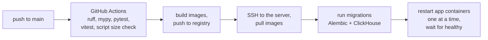

# Deployment on one VPS

> Part of the [system design](README.md).

Everything runs as one Docker Compose project on a single Linux server in the EU. The first draft of this design used Railway; [decision 17](decisions.md) explains the switch.

**The server**

| | |
|---|---|
| **Size** | 4 shared vCPU, 8 GB RAM, 80 GB local SSD, Ubuntu LTS |
| **Reference offer** | Hetzner CX33 in Germany or Finland: 8.49 EUR/month on Hetzner's price list of 15 June 2026 |
| **Ordered (T03)** | CPX32 in Helsinki, Ubuntu 26.04 LTS: 30.49 EUR/month on 2026-11-13, over the 15 EUR target, a stopgap while CX33 can't be ordered. x86 only: the `mieru-app` image is built for `linux/amd64` |
| **Why Hetzner** | EU company and data centres, hourly billing (useful for load tests), a firewall and backups from the provider |

> ⚠️ **Availability risk.** In October 2026 Hetzner's site marks its cost-optimized line, which CX33 belongs to, as "currently not available". The same size on the next line up (CPX32) costs several times more: the price paid is in the "Ordered" row. Nothing in this design is specific to Hetzner: any EU server of this size under 15 EUR/month will do. T03 checked what could be ordered; the result is the "Ordered" row above.

**Containers**

| Container | Image | Networks | Open to the internet | Restarted by an app deploy |
|---|---|---|---|---|
| `caddy` | caddy (official) | edge | ports 80, 443 (TCP) | Only when its config changes (`caddy reload`, not a restart) |
| `web` | No container. Static files from the `mieru-web` image, copied to disk by the deploy and served by `caddy` ([frontend.md](../frontend.md) section 3) | - | via Caddy | Files switched atomically |
| `ingest-1`, `ingest-2` | mieru-app | edge, internal | no | Yes, one at a time |
| `api` | mieru-app | edge, internal | no | Yes |
| `writer`, `worker` | mieru-app | internal | no | Yes |
| `postgres`, `redis`, `clickhouse` | official images | internal | no | No |
| `alloy` *(after MVP)* | grafana/alloy | internal | no | No |

**Routing (Caddy)**

| Request | Goes to |
|---|---|
| `in.mieru.example/*` | `ingest-1` and `ingest-2`, round robin. A replica that fails its health check leaves the rotation, and a request that can't connect is retried on the other |
| `mieru.example/api/*` | `api` |
| `mieru.example/*` | the web app's static files; unknown paths get `index.html` |
| any other host name | the connection is closed |

**How Caddy is set up**

One `Caddyfile` in `ops/caddy/` describes both sites.

- **TLS.** Caddy gets Let's Encrypt certificates itself, using the HTTP challenge on port 80, and renews them in the background. The certificates live in the `caddy-data` volume. There is no certbot, no renewal timer and no reload. On the Mac, the domain is `localhost`, and Caddy signs certificates with its own local authority instead.
- **Health and retries.** Active checks: Caddy asks each replica's `/health` every 2 seconds and takes a failing one out of the rotation. Passive checks: a failed request marks the replica down for a few seconds. When a connection fails, Caddy picks another replica and tries again for up to 5 seconds. A failed connection means the request was never sent, so this is safe even for a `POST`. Other failures are retried only for `GET`. Idle connections to the apps are closed after 4 seconds, before uvicorn's own 5-second limit, so Caddy never sends a request on a connection the app is closing.
- **Container addresses.** The upstreams are Compose service names. Caddy looks the name up in Docker's DNS on every new connection. A stopped container's name doesn't resolve, so the connection fails at once and is retried. A recreated container is found at its new address, with no reload. Adding replicas past fixed names would use `dynamic a` on a shared network alias, which gives up the active checks ([decision 24](decisions.md)).
- **Client IP.** Caddy sets `X-Real-IP` to the address of the TCP peer and removes `X-Forwarded-For` and `Forwarded` before proxying, so nothing the client sends gets through. `ingest` reads only `X-Real-IP`, and only from the proxy.
- **Privacy in logs.** The ingest site has no access log. The dashboard's access log and every other Caddy log line (errors, health checks, TLS) go through a filter that deletes the client address, the port, all request headers and the query string. The log level stays at `INFO`: at `DEBUG`, failed TLS handshakes print the client's address in the message text.
- **Headers.** HSTS, `X-Content-Type-Options`, `Referrer-Policy`, `Permissions-Policy`, and the CSP from [frontend.md](../frontend.md) on the dashboard. `Access-Control-Allow-Origin: *` on ingest only. The `Server` and `Via` headers are removed.
- **HTTP/3 off.** Caddy speaks HTTP/1.1 and HTTP/2 only. That keeps the firewall at TCP 80 and 443, and HTTP/3 adds nothing measurable for one small request per page view.
- **Health checks from outside.** On the dashboard host, `/health` and `/health/ready` also go to `api`, so an uptime check and the deploy can reach them at `https://mieru.example/health/ready`.

**Network and access**

- Databases sit on the `internal` Compose network and have no published ports.
- The provider's firewall, outside the server, allows only 22, 80 and 443. This matters because Docker writes its own packet-filter rules and bypasses a host firewall such as `ufw` for published ports.
- SSH with keys only; no root login, no passwords.
- Cloudflare hosts DNS in DNS-only mode ([decision 21](decisions.md)).
- DNS has A records only, no AAAA ([decision 30](decisions.md)).
- Server layout: one `deploy` user with an SSH key, the `docker` group and passwordless sudo ([decision 32](decisions.md)). The repository is checked out at `/srv/mieru`, and the stack's variables live in `/srv/mieru/.env`, mode 600 ([decision 33](decisions.md)). `ops/bootstrap.sh` prepares a fresh server; `ops/README.md` is the runbook.
- Secrets live in an `.env` file on the server, readable only by the deploy user, never in the repository. CI holds one SSH deploy key, in the GitHub `production` environment, which only `main` can use. It needs no registry token on the server: the image on GHCR is public, and CI pushes it with the job's own `GITHUB_TOKEN`.

**Deploy pipeline**

- **Who triggers it.** CI's `deploy` job runs after `publish` on every push to `main`. It calls `.github/workflows/deploy.yml`, which can also be run by hand with any commit on `main` ([decision 35](decisions.md)). CI on `main` runs one at a time, so deploys happen in merge order.
- **What the CI key can do.** It connects as `deploy`, and its line in `authorized_keys` forces `ops/deploy.sh` with `restrict`. The client's text is only the commit sha, and the script refuses anything but a full sha on `main` ([decision 34](decisions.md)).
- **`ops/deploy.sh`.** Stage 1 takes a lock, checks the commit, pulls its image and detaches the checkout at it; a failure there changes nothing. Then it `exec`s the target commit's own copy for stage 2, so a commit that changes the deploy steps is deployed by those steps. Stage 2 runs the migrations, sets `MIERU_TAG` in `.env`, restarts the app containers one at a time, and reloads Caddy's config.
- **No lost events during a deploy.** The script restarts `ingest-1`, waits until its `/health/ready` answers, waits 10 more seconds (longer than Caddy's `fail_duration` plus one health check interval, so Caddy routes to it again), then restarts `ingest-2`. While one replica is down, Caddy's health checks take it out of the rotation and any request that fails to connect is retried on the other. `api` has one replica, so the dashboard is unavailable for a few seconds while it restarts.
- **Clean shutdown.** On SIGTERM `ingest` finishes in-flight requests and `writer` finishes and acknowledges its current batch.
- **Failed migration** stops the deploy before any container restarts. Schema changes follow expand, migrate, contract so old and new code can overlap.
- **A failed deploy stops** where it failed and doesn't roll back by itself: the services it hadn't reached keep the old version ([decision 36](decisions.md)).
- **Rollback** is a deploy of an earlier commit on `main`, with the same script: the checkout, the config and the image (tagged with the commit) go back together.
- **Database containers and Caddy are not restarted** by an app deploy. A change to their service in `compose.prod.yaml` is applied by hand (`ops/README.md`).

**Backups and restore**

| What | How | Kept | Off the server |
|---|---|---|---|
| Whole disk | Provider backup, daily | 7 days | No (same provider) |
| Postgres | `pg_dump` nightly to Cloudflare R2 | 30 days | Yes |
| ClickHouse | `BACKUP` to R2, weekly | 4 weeks | Yes |
| Server setup | Bootstrap script and Compose file in the repo | git history | Yes |

R2's free tier covers 10 GB. Before launch, one restore drill: new server, bootstrap script, restore both databases, switch DNS. Target: under an hour.

**Keeping the server healthy:** automatic security updates, a size cap on container logs, a memory limit per container, containers set to start on boot, and a disk alert at 70%.

**Local development:** the same Compose file with a dev override. Postgres, Redis and ClickHouse run in Docker; the Python services and the web app run natively with reload.

**What this gives up compared with a platform like Railway:** a preview environment per pull request, managed TLS and deploys, and any protection against the server itself failing.

**MVP stack:** Caddy (which also serves the web app's files and renews its own certificates), two ingest replicas, api, writer, worker, Postgres, Redis and ClickHouse. That is 9 containers on 8 GB. Before adding a container, set a memory limit for each one and measure it.
