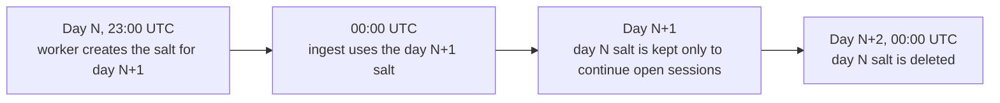
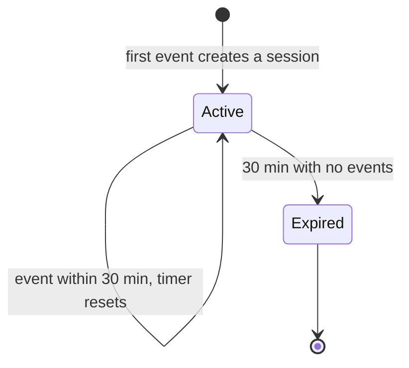

# Privacy and visitor identity

> Part of the [system design](README.md).

**The problem:** "unique visitors" needs some notion of the same person, and the usual answer is a cookie. Mieru uses none.

**The recipe** (Plausible's approach):

```text
visitor_id = BLAKE2b( key = salt_of_the_day,
                      data = site_domain | ip_address | user_agent )  -> 64-bit integer
```

- The **salt** is 16 random bytes, different for each UTC day.
- The same person on the same site on the same day gets the same id, so page views can be grouped into visits and counted as one visitor.
- The **domain** is in the hash, so the same person on two customer sites gets two unrelated ids. No cross-site tracking is possible.
- When a salt is deleted, nobody (including me) can recompute or reverse the ids made with it.

**Salt lifecycle**



Each salt row is stored with the date it belongs to, and `ingest` picks the salt by the event's UTC date. Creating tomorrow's salt an hour early removes any race at midnight.

**Sessions across midnight.** At 00:00 the visitor's id changes. To avoid cutting every open session in two, `ingest` also computes the id under yesterday's salt and sends both. The writer looks for a live session under today's id, then yesterday's.



**What is stored where**

| Data | `ingest` memory | Redis | ClickHouse | Logs |
|---|---|---|---|---|
| IP address | For one request | Never | Never | Never |
| User agent string | For one request | About 1 s (in the stream) | Never (only browser, OS, device) | Never |
| Visitor id (daily hash) | Yes | 30 min (session key) | Yes | Never |
| Country | Yes | Yes | Yes | Never |

**Known limits, accepted**

- The same person on two days counts as two visitors, so a 30-day "unique visitors" number is really "sum of daily uniques for returning visitors". Plausible has the same limit and documents it.
- Two devices are two visitors.
- People behind one office network with identical browsers merge into one visitor.
- Anyone can post fake events for any domain. This is true of all script-based analytics. Rate limits and bot filters bound the damage.
- The only hop in front of `ingest` is my own Caddy, with no access log for the ingest domain. DNS is at Cloudflare in DNS-only mode, so Cloudflare never sees a request. The hosting provider can see network metadata, as with any host.
