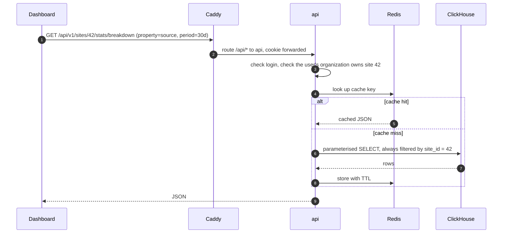

# Read path: dashboard queries

> Part of the [system design](README.md).



**One dashboard load is about eight queries** (top numbers, chart, six breakdowns), sent in parallel. Each is a single aggregate over one site's slice of `events` or `sessions`:

```sql
SELECT source, uniq(visitor_id) AS visitors
FROM events
WHERE site_id = 42
  AND timestamp >= '2026-10-01' AND timestamp < '2026-11-01'
  AND name = 'pageview'
GROUP BY source
ORDER BY visitors DESC
LIMIT 10;
```

**Query builder.** The API never accepts SQL or column names from the client. Metrics, dimensions and filters come from fixed lists and are turned into parameterised queries. `site_id` is added by the server after the membership check; this is the tenant boundary in ClickHouse.

**Caching**

| Range | TTL | Reason |
|---|---|---|
| Includes today | 30 s | Data is still arriving |
| Entirely in the past | 24 h | The data cannot change |
| Current visitors | 10 s | Shown as "live"; the dashboard polls every 30 s |

The cache key is a hash of site, metric, range and filters. The site's timezone is applied at query time.

**Guard rails for a 2 GB ClickHouse:** every query runs with a time limit (10 s), a memory limit and a low thread count, so one expensive query cannot starve inserts.

**Rollups: measure first.** Raw queries with the right sort key are expected to meet the 300 ms target at this scale. If the load test says otherwise, the next step is an hourly rollup table fed by a second materialized view. One detail matters there: **unique counts cannot be added up.** A visitor seen at 10:00 and at 11:00 is one visitor, not two, so an hourly table must store a mergeable sketch (`uniqState`) rather than a number, and the query merges sketches across hours. Page views, by contrast, are plain sums.
