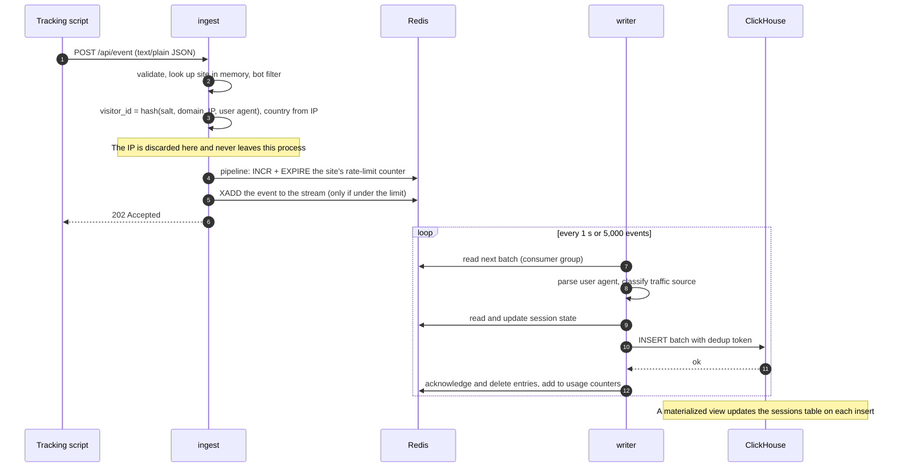

# Write path: from page view to ClickHouse

> Part of the [system design](README.md).

## What `ingest` does per request

In order. The cheap rejections come first.

1. **Parse and validate** the body: event name up to 120 characters, URL up to 2,000, at most 30 properties, body at most 8 KB (every limit: [conventions.md](../conventions.md) section 7.2). The route reads the raw bytes whatever the content type, because the tracker sends `text/plain`, and stops reading once the body is over 8 KB. A Pydantic model (`mieru.ingest.pipeline.IngestEvent`) validates them. A malformed body gets `400 invalid_event`, and the error never echoes the input.
2. **Site lookup** in an in-process dictionary that holds every site, keyed by normalized domain (`mieru.ingest.site_cache`). An unknown domain is a dictionary miss, so a flood for a fake domain never reaches Postgres ([decision 38](decisions.md)).
3. **Site status**: `blocked` and `over_quota` sites are dropped here.
4. **Bot filter**, in memory (`mieru.ingest.bots`). An empty user agent, or one with a crawler, headless-browser or HTTP-library token (`BOT_PATTERN`: `bot` but not `cubot`, `crawl`, `spider`, `headless`, `curl/`, `python-requests` and the like) is dropped as `bot`. A referrer whose host, or any parent domain of it, is on the spam list is dropped as `spam_referrer`. The list is Matomo's public-domain `spammers.txt`, vendored as `referrer_spam.txt` at a pinned commit and read once per process ([decisions 47 and 48](decisions.md)). An unknown site is reported before a bot, and a bot before `no_salt`.
5. **Visitor id**: a keyed hash over domain, IP and user agent, under today's salt, plus the same hash under yesterday's salt ([privacy.md](privacy.md)). No salt for today drops the event as `no_salt`. The IP is the one Caddy saw on the TCP connection, passed to `ingest` in an `X-Real-IP` header that Caddy sets itself. Without that header (a local run with no Caddy) it is the TCP peer. `X-Forwarded-For` and `Forwarded` are never read, and in production uvicorn runs with `--no-proxy-headers` so it doesn't rewrite the peer from them.
6. **Country**: lookup in a local IP-to-country database held in memory (DB-IP Lite, *est.* under 10 MB). Country only; city is a stretch goal because that database is many times larger and is loaded by every ingest container.
7. **Discard the IP.**
8. **Two Redis calls, no script** (`mieru.ingest.delivery.Delivery.send`). Before any call, two checks in memory: a stream over the high-water mark drops the event as `backpressure`, and a non-empty fallback queue means Redis failed a moment ago, so the event joins the queue (see "Buffering and backpressure"). Then a pipeline without `MULTI` increments the site's counter for the UTC minute and sets its expiry (`INCR rl:{site_id}:{minute}`, `EXPIRE … 120 NX`). If the count is over the site's `rate_limit_per_min`, the event is dropped as `rate_limited`. Otherwise `XADD` appends it to the stream. The extra round trip on the internal network costs well under a millisecond. The check and the append are not atomic, so a few extra events can get in right at the limit, which does not matter for a rate limit ([decision 23](decisions.md)). The window is fixed, so across a minute's edge a site can get up to twice its limit.
9. **Answer `202`.** If the event was dropped at any step, the answer is still `202`, with an `X-Mieru-Dropped: <reason>` header. Every outcome is counted in memory (`mieru.ingest.counters`): kept and held events as accepted, drops by reason. The counts are logged as `events_counted` every 60 s and at shutdown, then reset ([decision 50](decisions.md), [observability.md](observability.md)).

Nothing in this list waits on Postgres or ClickHouse. If both are down, ingest keeps accepting.

**The caches.** Steps 2 and 5 read two in-process caches: every site, and the salts of yesterday, today and tomorrow. Before it serves, `ingest` loads both from Postgres (`mieru.ingest.refresh.refresh_once`), creating today's and tomorrow's salts when they're missing. If Postgres can't be reached, startup fails and Docker restarts the container ([decision 39](decisions.md)). A background task then reloads both every 30 s. A failed reload logs `cache_refresh_failed` with the error type and keeps the old caches, so a Postgres outage doesn't stop collection until the cached salts run out: they reach only to tomorrow, so past that day every event is dropped as `no_salt`. A new or changed site therefore takes up to 30 s to count. T17 adds an immediate reload through `sites:version`.

**Built so far** (T07, T12): every step but 6. The country comes with T13 (until then `cc` is `ZZ`). `over_quota` is a status nothing sets yet: usage limits come after the MVP.

## What `writer` does per batch

1. **Read** up to 5,000 entries from the stream as a member of a consumer group. A consumer group is Redis's way of tracking which entries have been handed out and which have been acknowledged.
2. **Parse the user agent** into browser, OS and device type. Parsing is slow (many regular expressions), so results are cached by user-agent string; real traffic has few distinct strings.
3. **Classify the source**: referrer host and UTM tags become a source name ("Google", "Hacker News", "Direct").
4. **Assign the session.** Look up `sess:{site}:{visitor}` in Redis. If it exists, reuse its `session_id` and its first-touch attributes (source, UTM, country, device). If not, create one. Either way reset its 30-minute expiry. All lookups for a batch go in one pipeline.
5. **Insert** the batch into ClickHouse in one statement.
6. **Acknowledge** the entries, delete them from the stream, and add the batch's per-organization counts to the monthly usage counters.

The raw user agent sits in the stream for about a second and is not stored in ClickHouse.

**Built so far** (T08): steps 1, 5 and 6, without the usage counters. `python -m mieru.writer` reads as consumer `writer-1` of group `writers` (`mieru.writer.consumer`):
- **The group.** At startup `ensure_group` runs `XGROUP CREATE events writers 0 MKSTREAM`, so entries that ingest wrote before the writer's first start are read too. If Redis can't be reached, the process exits 1 and Docker restarts it. A `NOGROUP` reply later (the stream was deleted) creates the group again.
- **A batch.** Each cycle first reads the consumer's own pending entries (id `0`) and returns them as they are, never topped up, so a retried batch is the same batch. With none pending, it reads new entries (`>`) until it holds `WRITER_BATCH_MAX` (5,000) or `WRITER_FLUSH_MS` (1,000) has passed since the first one arrived. No blocking read waits longer than 1 s, which keeps it under the Redis client's 2 s socket timeout and lets a stop be seen within a second.
- **Rows.** The pure steps `mieru.writer.batch.build_batch` and `mieru.writer.enrich.to_row` turn entries into `EventRow`s: host and path from the URL, the timestamp from `ts`, and no `ua` or `org_id`. Until T13 the enrichment columns are `''`; until T14 `session_id` is `0` and `session_start` is the event's time. An entry that doesn't parse is acknowledged, deleted and logged as `entry_invalid` with its id and the error type, so it can't block the stream. It isn't moved to a dead-letter stream, which would keep its raw user agent in Redis.
- **Insert, then acknowledge.** One `INSERT` per batch (`mieru.writer.inserter.insert_rows`) carries the dedup token, then `XACK` and `XDEL` of every id in the batch go in one `MULTI`. The cycle logs `batch_inserted` with `rows`, `invalid` and `ms`.
- **Failure.** A failed cycle acknowledges nothing, logs `batch_failed` with the error type and `retry_in_s`, and waits 1, 2, 4 ... up to 30 s before it tries again.
- **Stop.** SIGTERM or SIGINT stops the collecting. The writer stores and acknowledges what it holds, closes its clients, logs `shutdown_complete` and exits 0. A stop during a backoff pause ends the pause, and the batch stays pending for the next start.

## Buffering and backpressure

The stream is the shock absorber between a spiky input and a database that wants steady batches.

- **Normal:** the stream holds under a second of events.
- **ClickHouse slow or down:** the writer retries its batch with backoff. Entries pile up in Redis. At the expected load the 200,000-entry limit is hours of buffer; at the peak test rate it is about three minutes.
- **Stream over the limit:** a background task in `ingest` (`Delivery.run`) reads `XLEN events` once a second. While the last reading is over `STREAM_HIGH_WATER` (200,000), new events are dropped with reason `backpressure`, without a Redis call. This is deliberate: an explicit, counted drop at the door instead of Redis running out of memory or silently trimming unprocessed entries. The mark can be overshot by up to a second of traffic. If Redis can't answer, the last reading stays.
- **Redis unreachable:** the first event whose Redis call fails logs `redis_unavailable` with the error type and goes into a bounded in-process FIFO queue (`INGEST_FALLBACK_QUEUE`, 10,000). From then on, while the queue holds anything, new events join its end without touching Redis: no request waits out the 2 s socket timeout, and the stream keeps post order. Held events skip the rate limit, and they count as accepted. When the queue is full, an event is dropped as `redis_unavailable`, and `fallback_full` is logged once per outage. The same background task writes the held events back, oldest first, 500 per `MULTI`, every second. A batch leaves the queue only after `EXEC` succeeds, and `fallback_drained` logs the count once the queue is empty. At shutdown a last drain gets 5 s, and whatever is still held is logged as `fallback_lost` ([decision 49](decisions.md)).
  - **What it costs.** A crash loses what is held (at most 10,000 events). A reply lost after `EXEC` makes the retry write the batch twice; the writer's dedup token doesn't catch that, because the stream ids differ. A held burst isn't rate-limited.

## Delivery guarantees

The pipeline is **at-least-once**: an entry is deleted from the stream only after ClickHouse confirms the insert. The one failure that causes a repeat is "insert succeeded, acknowledgement did not" (the writer crashes in between).

The fix (T08): the writer re-reads its unacknowledged entries on restart, which reproduces the same batch, and sends it with `insert_deduplication_token` set to `<first stream id>:<last stream id>`. ClickHouse then ignores a batch it has already stored, within the table's window of the last 1,000 blocks. The same rows under two different tokens are stored twice, so two different batches with identical rows both count. Session assignment (T14) is safe to repeat because the Redis session record holds only the id, the start time and first-touch attributes, no counters. T14's writer crash test proves the whole path end to end.

A SIGKILL in the middle of an insert loses nothing either: the batch stays pending, and the token makes the retry a no-op.
