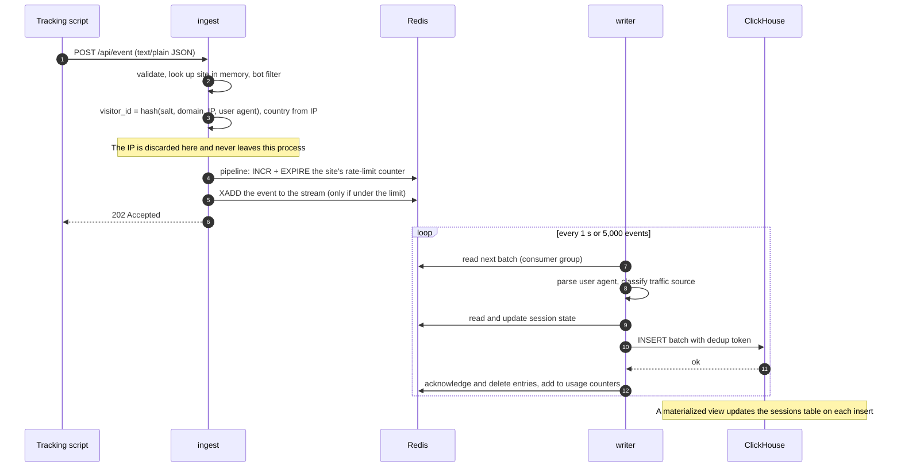

# Write path: from page view to ClickHouse

> Part of the [system design](README.md).

## What `ingest` does per request

In order. The cheap rejections come first.

1. **Parse and validate** the body: event name up to 120 characters, URL up to 2,000, at most 30 properties, body at most 8 KB. A malformed body gets `400`.
2. **Site lookup** in an in-process dictionary keyed by domain, refreshed from Postgres every 30 s. An unknown domain costs one lookup and is then remembered as unknown for 60 s, so a flood for a fake domain stays in memory.
3. **Site status**: `blocked` and `over_quota` sites are dropped here.
4. **Bot filter**: empty or known-bot user agents, headless browsers, referrers on a spam blocklist.
5. **Visitor id**: a keyed hash over domain, IP and user agent ([privacy.md](privacy.md)). The IP is the one Caddy saw on the TCP connection, passed to `ingest` in an `X-Real-IP` header that Caddy sets itself. `X-Forwarded-For` and any other forwarding header sent by the client are ignored.
6. **Country**: lookup in a local IP-to-country database held in memory (DB-IP Lite, *est.* under 10 MB). Country only; city is a stretch goal because that database is many times larger and is loaded by every ingest container.
7. **Discard the IP.**
8. **Two Redis calls, no script.** First, a pipeline increments the site's per-minute counter and sets its expiry (`INCR rl:{site_id}:{minute}`, `EXPIRE … 120 NX`). If the count is over the site's limit, the event is dropped as `rate_limited`. Otherwise `XADD` appends it to the stream. The extra round trip on the internal network costs well under a millisecond. The check and the append are not atomic, so a few extra events can get in right at the limit, which does not matter for a rate limit ([decision 23](decisions.md)).
9. **Answer `202`.** If the event was dropped at any step, the answer is still `202`, with an `X-Mieru-Dropped: <reason>` header, and a counter for that reason goes up.

Nothing in this list waits on Postgres or ClickHouse. If both are down, ingest keeps accepting.

## What `writer` does per batch

1. **Read** up to 5,000 entries from the stream as a member of a consumer group. A consumer group is Redis's way of tracking which entries have been handed out and which have been acknowledged.
2. **Parse the user agent** into browser, OS and device type. Parsing is slow (many regular expressions), so results are cached by user-agent string; real traffic has few distinct strings.
3. **Classify the source**: referrer host and UTM tags become a source name ("Google", "Hacker News", "Direct").
4. **Assign the session.** Look up `sess:{site}:{visitor}` in Redis. If it exists, reuse its `session_id` and its first-touch attributes (source, UTM, country, device). If not, create one. Either way reset its 30-minute expiry. All lookups for a batch go in one pipeline.
5. **Insert** the batch into ClickHouse in one statement.
6. **Acknowledge** the entries, delete them from the stream, and add the batch's per-organization counts to the monthly usage counters.

The raw user agent sits in the stream for about a second and is not stored in ClickHouse.

## Buffering and backpressure

The stream is the shock absorber between a spiky input and a database that wants steady batches.

- **Normal:** the stream holds under a second of events.
- **ClickHouse slow or down:** the writer retries its batch with backoff. Entries pile up in Redis. At the expected load the 200,000-entry limit is hours of buffer; at the peak test rate it is about three minutes.
- **Stream over the limit:** `ingest` checks the stream length once a second and, above the high-water mark, drops new events with reason `backpressure`. This is deliberate: an explicit, counted drop at the door instead of Redis running out of memory or silently trimming unprocessed entries.
- **Redis unreachable:** `ingest` holds up to 10,000 events in a bounded in-process queue and retries. When that is full it drops and counts.

## Delivery guarantees

The pipeline is **at-least-once**: an entry is deleted from the stream only after ClickHouse confirms the insert. The one failure that causes a repeat is "insert succeeded, acknowledgement did not" (the writer crashes in between).

Planned fix, to be proven by a test during the build: the writer re-reads its unacknowledged entries on restart, which reproduces the same batch, and sends it with an `insert_deduplication_token` derived from the first and last stream ids. ClickHouse then ignores a batch it has already stored. Session assignment is safe to repeat because the Redis session record holds only the id, the start time and first-touch attributes, no counters.

Without the token the fallback is to accept rare duplicates, which is what most analytics pipelines do.
