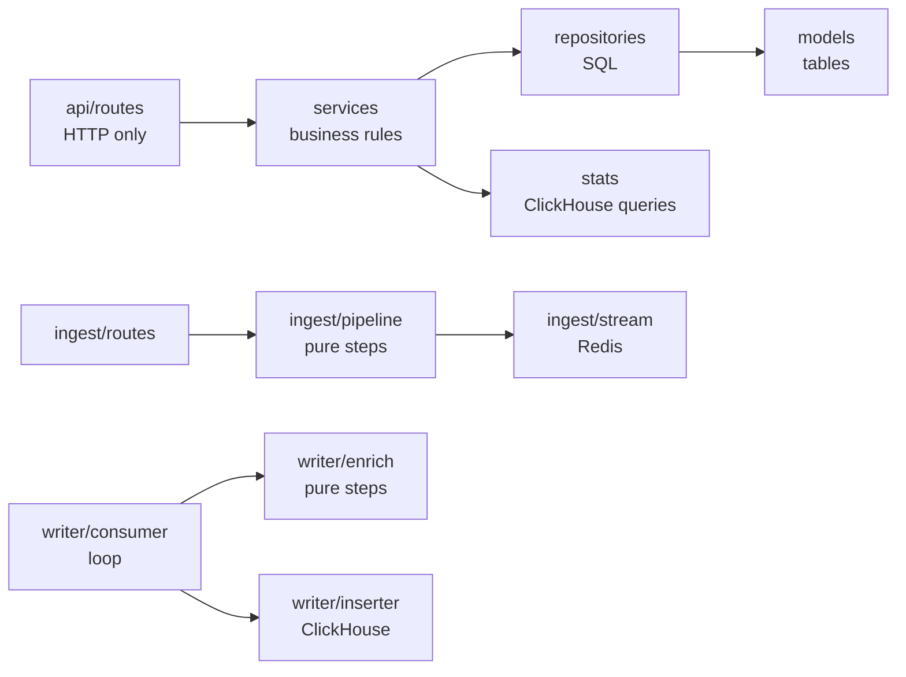

# Mieru: conventions

> The rules every task follows: where files live, what things are called, how code is layered, how it is tested, and the security and privacy rules. This is the one place for them. If another doc or a task spec disagrees, this file wins, and the other one gets fixed.
> *What* Mieru does: [product.md](product.md). *How* it works: [architecture.md](architecture.md). The React app: [frontend.md](frontend.md). How a task runs: [workflow.md](workflow.md).

---

## 1. Repository layout

One repository, three apps, one `docs/` folder. A change that touches the API and the dashboard lands in one pull request.

This is the target layout. Folders marked *(later)* don't exist yet; the first task that needs one creates it.

```text
mieru/
├── CLAUDE.md                 # context for Claude Code (public)
├── CLAUDE.local.md           # the developer's private notes for Claude (gitignored)
├── README.md
├── compose.yaml              # local dev: postgres, redis, clickhouse
├── compose.prod.yaml         # the server: caddy, apps, databases
├── .env.example              # every backend setting, with a comment
├── .github/
│   ├── workflows/ci.yml      # lint, types, tests; image push on main
│   └── pull_request_template.md
├── .claude/                  # shared Claude Code setup (public)
│   ├── settings.json         # permissions and hooks
│   ├── hooks/                # format.sh, protect.sh
│   ├── agents/               # test-writer, verifier, reviewer
│   └── skills/               # task, verify, status
├── docs/
│   ├── product.md            # problem, users, stories and acceptance criteria, scope
│   ├── architecture.md       # system design and trade-offs
│   ├── frontend.md           # design of the React app
│   ├── conventions.md        # this file
│   ├── roadmap.md            # the "Now" block and the task list
│   ├── workflow.md           # how to work on a task
│   ├── features.json         # one entry per feature, with the check that proves it
│   ├── tasks/                # T07-sites-api.md ... task specs (public)
│   └── learn/                # human-mode tutorials (gitignored)
├── ops/
│   ├── README.md             # runbook: a fresh server to a running stack
│   ├── clickhouse/           # low-memory.xml, users.xml
│   ├── caddy/                # Caddyfile: both sites, TLS, routing, headers, log filters
│   ├── rehearsal.env         # dummy values for running compose.prod.yaml on a Mac
│   ├── server.env.example    # names of the variables in the server's .env
│   ├── bootstrap.sh          # fresh Ubuntu server, ready for deploys
│   ├── deploy.sh             # (later) pull, migrate, rolling restart
│   ├── backup/               # (later) pg_dump and ClickHouse backup scripts, restore-check.sh
│   └── drills/               # (later) scripts run against the server, e.g. deploy-under-traffic.sh
└── apps/
    ├── backend/              # one Python package, four entrypoints, one image (mieru-app)
    │   ├── pyproject.toml    # dependencies and ruff, mypy, pytest config
    │   ├── uv.lock
    │   ├── Dockerfile
    │   ├── migrations/       # (later) Alembic, Postgres only
    │   ├── clickhouse/       # (later) 0001_events.sql ... applied by mieru.tools.ch_migrate
    │   ├── data/             # (later) dbip-country-lite.mmdb, downloaded, gitignored
    │   ├── src/mieru/
    │   │   ├── core/         # config, logging, errors, clock, redis, clickhouse, health
    │   │   ├── db/           # SQLAlchemy engine and sessions
    │   │   ├── models/       # (later) SQLAlchemy tables: the database shape
    │   │   ├── schemas/      # (later) Pydantic models: the API shape
    │   │   ├── repositories/ # (later) SQL only, always scoped by org or site
    │   │   ├── services/     # (later) business rules: auth, sites, salts
    │   │   ├── api/          # dashboard API: app.py, deps.py, routes/
    │   │   ├── ingest/       # app, routes, pipeline, bots, visitor, geo, salts, site_cache, stream
    │   │   ├── writer/       # (later) __main__, consumer, enrich, useragent, sources, sessions, inserter
    │   │   ├── stats/        # (later) query_builder, metrics, filters, cache
    │   │   ├── worker/       # (later) __main__ with the scheduler loop, tasks
    │   │   └── tools/        # (later) seed.py, ch_migrate.py
    │   └── tests/
    │       ├── unit/         # no I/O, milliseconds
    │       ├── integration/  # real Postgres, Redis and ClickHouse from compose
    │       └── e2e/          # (later) the whole pipeline: payload -> ClickHouse -> stats API
    ├── web/                  # (later) the React dashboard; design in frontend.md
    │   ├── index.html
    │   ├── vite.config.ts    # React, Tailwind, the router plugin, dev proxy /api -> :8000
    │   ├── components.json   # shadcn config
    │   ├── public/           # favicon.svg, theme-init.js
    │   ├── src/
    │   │   ├── main.tsx      # query client, router, providers
    │   │   ├── routeTree.gen.ts  # generated by the router plugin; never edit
    │   │   ├── styles.css    # Tailwind and the design tokens (light and dark)
    │   │   ├── routes/       # file-based routes: __root.tsx, login.tsx, _app.tsx, _app/sites/$siteId/index.tsx ...
    │   │   ├── api/          # schema.d.ts (generated; never edit), client.ts, errors.ts
    │   │   ├── features/     # auth/, sites/, dashboard/: components, queries, schemas
    │   │   ├── components/   # ui/ (shadcn, owned by the repo) and app-wide components
    │   │   ├── lib/          # format.ts, cn.ts
    │   │   └── test/         # setup, MSW handlers, render helpers
    │   └── e2e/              # Playwright journeys
    └── tracker/              # (later) the tracking script
        ├── src/p.js
        ├── build.mjs         # minify -> dist/p.js, print the gzipped size, fail over budget
        └── test/
```

**One backend package, four entrypoints.** `ingest`, `api`, `writer` and `worker` share models, config and helpers. One package and one image means one set of dependencies and one build. Each container starts a different module (section 3).

**`src/` layout.** Tests import the installed package (`from mieru.core.config import Settings`), not whatever is in the current folder. That removes a whole class of import bugs.

**Public and private.** The repository is public. Everything in it is project material, including the agent setup in `.claude/` and the task specs. Only `docs/learn/`, `.claude/skills/task/human.md`, `CLAUDE.local.md` and `.claude/settings.local.json` are private and gitignored. Public files never link to private ones.

**Decisions** go in [architecture.md](architecture.md) section 13 as a table row. A decision that needs more than a row gets an ADR in `docs/adr/NNNN-<slug>.md` with four parts: Context, Decision, Alternatives, Consequences.

---

## 2. Backend layering



1. **Dashboard API:** `routes -> services -> repositories -> models`. A route parses the request, calls one service function and returns a schema. Nothing skips a layer, and nothing imports upwards. Routes never touch SQL.
2. **Pipelines (ingest, writer):** a pure function for each step (validate, classify, hash, enrich) and thin adapters for I/O (Redis, ClickHouse). The pure steps are unit-tested in milliseconds; only the adapters need real databases.
3. **Tenant boundary:** every repository function on tenant data takes `org_id` or `site_id`. Every ClickHouse query gets `site_id` from the server after a membership check, never from the client.
4. **Time:** code never calls `datetime.now()`. It calls `mieru.core.clock.now()` or `clock.today()`, so tests can freeze time. Salts, sessions and quotas all depend on dates.
5. **Errors:** raise a subclass of `AppError` from `mieru.core.errors`. One handler turns every error into `{"error": {"code", "message", "details"}}` (codes in section 5).
6. **Async everywhere.** A blocking library call runs through `await asyncio.to_thread(...)`.

---

## 3. Names

**Services, entrypoints and ports** (commands from `apps/backend`)

| Service | Start command | Local port | Exists |
|---|---|---|---|
| `api` | `uv run uvicorn --factory mieru.api.app:create_app --reload --port 8000` | 8000 | yes |
| `ingest` | `uv run uvicorn --factory mieru.ingest.app:create_app --reload --port 8001` | 8001 | yes |
| `writer` | `uv run python -m mieru.writer` | none | later |
| `worker` | `uv run python -m mieru.worker` (an asyncio scheduler loop; no task queue in the MVP) | none | later |
| `web` | `pnpm --dir apps/web dev` (Vite; proxies `/api` to port 8000) | 3000 | later |
| Postgres, Redis, ClickHouse | `docker compose up -d` from the repo root | 5432, 6379, 8123 | yes |

**URLs**

| Path | Served by |
|---|---|
| `https://mieru.example/` | `web` |
| `https://mieru.example/api/v1/...` | `api` |
| `https://in.mieru.example/api/event` | `ingest` |
| `https://in.mieru.example/js/p.js` | `ingest` (the built tracker) |
| `/health`, `/health/ready` | every HTTP service |
| `/api/v1/version` (api), `/version` (ingest) | `{"version": GIT_SHA}` |
| `/api/v1/openapi.json`, `/api/v1/docs` | `api` only; ingest has no OpenAPI |

**Settings.** Every backend setting is in `.env.example`, with a comment, and is read by `mieru.core.config.Settings`. Add a setting in both places in the same commit. Secrets are `SecretStr`, and URLs that carry a password are `Secret[...]` (for example `Secret[PostgresDsn]`); read them with `.get_secret_value()`.

**Data names**

| Thing | Name |
|---|---|
| Postgres database / test database | `mieru` / `mieru_test` |
| ClickHouse database / test database | `mieru` / `mieru_test` |
| ClickHouse tables | `events`, `sessions`, `sessions_mv`, `schema_migrations` |
| ClickHouse read-only user for stats | `mieru_reader`, in `ops/clickhouse/users.xml` |
| Redis stream / consumer group / consumer | `events` / `writers` / `writer-1` |
| Redis keys | [architecture.md](architecture.md) section 7.3, plus `auth:{token_hash}` (session lookup cache, 60 s), `sites:version` (site cache invalidation) and `rl:login:{sha256(ip)[:16]}:{minute}` (5 logins a minute) |
| Redis database for tests | 15 |
| Drop reasons (header `X-Mieru-Dropped`, log and metric label) | `unknown_site`, `blocked`, `over_quota`, `bot`, `spam_referrer`, `rate_limited`, `backpressure`, `redis_unavailable` |
| Session cookie | `mieru_session` |
| Dev email outbox (when `RESEND_API_KEY` is empty) | `apps/backend/.outbox/` |

**Work items**

| Kind | Pattern | Example |
|---|---|---|
| Task spec (public) | `docs/tasks/T<NN>-<slug>.md` | `docs/tasks/T07-sites-api.md` |
| Human-mode tutorial (private) | `docs/learn/T<NN>-<slug>.md` | `docs/learn/T10-ingest.md` |
| Branch | `t<nn>-<slug>` | `t07-sites-api` |
| Feature id | as in [features.json](features.json) | `T1`, `I2`, `OPS1` |

Task ids (`T01`) and feature ids (`T1`, tracking) are different things: a task builds one or more features.

---

## 4. Code style

**Python**

- Python 3.13, managed by uv. Type hints everywhere; `mypy --strict` passes.
- Ruff formats and lints. The rules live in `apps/backend/pyproject.toml`, which is the only copy.
- `snake_case` for functions and variables, `PascalCase` for classes, `UPPER_CASE` for constants. Modules are short nouns: `visitor.py`, not `visitor_utils.py`.
- Pydantic models for anything that crosses a boundary (HTTP, a Redis entry, a ClickHouse row). Dataclasses for internal values.
- Structured logs only: `log.info("batch_inserted", rows=n, ms=t)`. No f-strings in log messages. Never an IP address, a user agent or a request body.
- A docstring on every public function: one line on what it does, and one on why if that isn't obvious.
- Comments explain a non-obvious line or a reason. They are written for a public repository.

**TypeScript and React** (design: [frontend.md](frontend.md))

- TypeScript `strict` plus `noUncheckedIndexedAccess`. No `any`: use `unknown` and narrow it.
- ESLint (typescript-eslint type-checked rules, react-hooks, jsx-a11y, the TanStack Query and Router plugins) and Prettier with the Tailwind class sorter. pnpm, Node LTS.
- Files: components are `PascalCase.tsx` with one exported component each; hooks are `useThing.ts`; everything else is `camelCase.ts`. Tests sit next to the code as `Thing.test.tsx`. Route files follow TanStack Router's naming (`__root.tsx`, `_app.tsx`, `$siteId`).
- Named exports only, except a route file's `Route`. Imports use the `@/` alias for `src/`.
- A feature imports from `api/`, `components/` and `lib/`, and from another feature only through that feature's `index.ts`.
- Server data only through a feature's `queryOptions` factories. No `fetch` in components, no hand-written response types.
- Styling with Tailwind classes and the design tokens, never raw colours; `cn()` merges classes.
- Memoize (`useMemo`, `useCallback`, `memo`) only when the profiler shows a need.
- Commands: `pnpm --dir apps/web dev`, `build`, `typecheck`, `lint`, `test`, `test:e2e`, `size`, `api:types`.

**Tracker:** plain JavaScript, no dependencies. The budget is 1,024 bytes gzipped, and the build fails above it.

---

## 5. Shared interfaces

Fixed here so that tasks written weeks apart fit together. Specs use these names.

**Ingest body:** [architecture.md](architecture.md) section 9.

**Stream entry** (written by `ingest`, read by `writer`): fields `v` (format version), `site_id`, `org_id`, `ts` (ms), `n`, `u`, `r`, `ua`, `vid`, `pvid` (yesterday's visitor id), `cc` (country), `p` (props as JSON). A contract test builds an entry with the real ingest code and reads it with the real writer code (section 6).

**Session record** (`sess:{site_id}:{visitor_id}`): `sid`, `start`, `last`, `source`, `referrer`, `utm_*`, `cc`, `device`, `browser`, `os`.

**Data rules**

- An unknown country is `ZZ`.
- Domains are lowercased, and a leading `www.` is removed.
- Session ids are `secrets.randbits(63)`, so they fit a signed 64-bit integer.
- A site's default `rate_limit_per_min` is 6000.

**Stats API** (`/api/v1/sites/{site_id}/stats/{aggregate|timeseries|breakdown|realtime}`)

| Parameter | Values |
|---|---|
| `period` | `today`, `yesterday`, `7d`, `30d`, `month`, `12mo`, `custom` (with `from` and `to` as `YYYY-MM-DD`, inclusive, in the site's timezone) |
| `metrics` | comma list of `visitors`, `visits`, `pageviews`, `events`, `bounce_rate`, `visit_duration` |
| `property` (breakdown) | `source`, `utm_source`, `utm_medium`, `utm_campaign`, `page`, `entry_page`, `exit_page`, `country`, `device`, `browser`, `os` |
| `filters` | `property==value` pairs joined by `;`, for example `source==Google;country==DE` |
| `interval` (timeseries) | `hour`, `day` |
| `limit`, `page` | breakdown paging; defaults 10 and 1 |

Response shapes, in order: aggregate, timeseries, breakdown, realtime.

```json
{"results": {"visitors": {"value": 120, "change": null}, "pageviews": {"value": 340, "change": null}}}
{"results": [{"date": "2026-11-01", "visitors": 10, "pageviews": 31}]}
{"results": [{"source": "Google", "visitors": 30, "pageviews": 50}], "next_page": 2}
{"visitors": 7}
```

`change` is `null` until comparison exists.

**Error codes.** `mieru.core.errors` defines `not_found` (404), `conflict` (409), `unauthorized` (401), `forbidden` (403), `quota_exceeded` (402), `validation_failed` (422), `rate_limited` (429) and `internal_error` (500). Tasks add `invalid_domain`, `bad_origin` (403) and `stats_unavailable` (503). In production a 500 never shows internals; the response carries the `X-Request-Id`.

**Backend names fixed in advance**

| Area | Names |
|---|---|
| Core | `mieru.core.security`: `new_token`, `hash_token`, `hash_password`, `verify_password` |
| Services | `services/sites.py`, `services/salts.py` (`ensure_salts`) |
| Repositories | `get_site_for_user(session, user_id, site_id)`, `get_site_by_domain(session, domain)` |
| Postgres | `email_tokens(id, user_id, token_hash unique, purpose, expires_at, used_at)` for email links |
| ClickHouse | migrations `0000_schema_migrations.sql` ... `0003_sessions_mv.sql`, one statement per file; `events` has `non_replicated_deduplication_window = 1000` |
| Worker | `rotate_salts` |
| Tools | `python -m mieru.tools.seed --site-id 1 --events 1000000 --days 90` (fake traffic into ClickHouse); `python -m mieru.tools.ch_migrate` (applies `clickhouse/*.sql` in order) |
| Tracker | `build.mjs` writes `dist/p.js` and copies it to `apps/backend/src/mieru/ingest/static/p.js` (gitignored), which `ingest` serves |

### Later (after the MVP)

Names reserved so later work fits. Don't build them in MVP tasks.

| Area | Names |
|---|---|
| Stats API | metric `conversion_rate`; properties `goal`, `prop:<key>`; filter `goal==<goal_id>`; `compare=previous_period`; `GET .../stats/export` (CSV); the same stats under `/api/v1/share/{slug}/stats/...` |
| Endpoints | `GET /api/v1/sites/{site_id}/shared-links`, `DELETE /api/v1/shared-links/{id}`, `PATCH /api/v1/alerts/{id}`, `DELETE /api/v1/me` (deletes the account and all its data), `GET/POST /api/v1/api-keys`, `DELETE /api/v1/api-keys/{id}`, `POST /api/v1/client-errors` (frontend errors, rate limited) |
| Error codes | `plan_limit_reached`, `invalid_signature` |
| Services | `services/plans.py` |
| Worker tasks | `persist_usage`, `reconcile_usage`, `update_quota_status`, `evaluate_spike_alerts`, `send_weekly_reports`, `send_email`, `process_stripe_event`, `notify_first_event` |
| Redis | `chan:verify:{token_hash}` (24 h), `rl:apikey:{key_id}:{hour}` |
| Telemetry | `mieru.ingest.requests`, `mieru.ingest.duration`, `mieru.ingest.dropped` (label `reason`), `mieru.stream.length`, `mieru.stream.oldest_age`, `mieru.writer.batch_size`, `mieru.writer.insert.duration`, `mieru.writer.insert.failures`, `mieru.stats.query.duration` (label `kind`), `mieru.stats.cache` (label `result`), `mieru.worker.job.failures` (label `task`); the stream entry gains `tp` (traceparent) |
| Load tests | scenarios in `ops/k6/scenarios/`; headers `X-Mieru-Loadtest: <LOADTEST_SECRET>` and `X-Mieru-Visitor-Seed: <int>`, honoured only when `LOADTEST_SECRET` is set and matches |
| ClickHouse | `events_hourly` and `events_hourly_mv`, only if load tests show they are needed |

---

## 6. Testing

### 6.1 Principles

1. **Test behaviour, not implementation.** "An event for an unknown site is dropped with `unknown_site`", not "`site_cache.get` was called once". A refactor shouldn't break a test.
2. **Real databases, not mocks.** Postgres, Redis and ClickHouse run in Compose locally and as service containers in CI. Mock only what you don't own and can't run: Stripe, Resend, outside HTTP.
3. **Pure code gets most of the tests.** The pipeline and enrichment steps are pure functions (section 2), so most logic is tested in milliseconds.
4. **Every guarantee in the design has a test.** At-least-once without double counting: the writer crash test. No IP stored: the privacy test (section 7.6). Tenant isolation: the cross-org test (section 7.4).
5. **A test that never failed proves nothing.** Write it, watch it fail for the right reason, then make it pass.

### 6.2 Layers

| Layer | Proves | Tools | Where |
|---|---|---|---|
| Unit | Pure logic: validation, drop rules, visitor id, user-agent mapping, sources, query builder SQL | pytest, hypothesis | `tests/unit/` |
| Integration | One component with its real store: repositories, auth, the rate limit and stream append, writer to ClickHouse, stats queries, worker jobs | pytest + Compose | `tests/integration/` |
| Contract | Two sides agree: OpenAPI and the generated TypeScript types; the stream entry written by ingest and read by writer | CI diff check; `tests/unit/contracts/` | CI, `tests/unit/` |
| Pipeline end to end | Payload -> ingest -> stream -> writer -> ClickHouse -> stats API | pytest marker `e2e` | `tests/e2e/` |
| Privacy | No IP or user agent in any store or log | pytest marker `e2e` | `tests/e2e/test_privacy.py` |
| Tracker | The right request, only when it should be sent; the size budget | Vitest, Playwright, `build.mjs` exit code | `apps/tracker/test/` |
| Web | Per [frontend.md](frontend.md) | | `apps/web/` |
| Load and resilience *(after MVP)* | Throughput, latency, no loss under failure | k6 | `ops/k6/` |

**Layout.** Tests mirror the source tree: `tests/{unit,integration}/<area>/test_<module>.py`, for example `tests/unit/ingest/test_bots.py`.

**Markers.** `integration` (needs compose), `e2e` (needs every service), `slow` (over a second). Plain `uv run pytest` runs everything except `e2e`. The fast loop is `uv run pytest -m "not integration and not e2e"`.

### 6.3 Real databases

| Store | Test target | Isolation |
|---|---|---|
| Postgres | database `mieru_test` | Migrated once per run; each test runs in an outer transaction that is rolled back |
| Redis | database 15 | `FLUSHDB` before each test that asks for Redis |
| ClickHouse | database `mieru_test` | Migrated once per run, tables truncated once at the start. Each test gets a fresh `site_id` from a counter starting at 100,000, so tests never see each other's rows |

ClickHouse has no cheap rollback, and truncating per test costs tens of milliseconds. Every real query filters by `site_id` anyway, so a unique id per test is free isolation.

### 6.4 Time and data

- Tests freeze or move time with `time-machine`. Code reads time only through `mieru.core.clock`.
- Cases worth a test: 23:59:59 to 00:00:00 UTC (salts); a 29- vs 31-minute gap (sessions); a UTC timestamp that falls on another date in the site's timezone (timeseries buckets); a daylight-saving change in `Europe/Kyiv`.
- Factories in `tests/factories.py` build valid objects with overridable defaults, so a test states only what matters to it.
- Stats tests use `mieru.tools.seed` with a fixed seed and small counts, so the answers are known ("300 page views, 100 visitors").
- Property tests (hypothesis) for parsers and the hash: URL and UTM parsing, source classification, domain normalisation, the filter parser, `visitor_id`, and "any request body either validates or raises `ValidationError`, never a 500".

### 6.5 The two most important tests

**The pipeline test** (`tests/e2e/test_pipeline.py`): create an org and a site, make sure today's salts exist, post a page view and a custom event with props to the real ingest app, run one writer cycle, then check ClickHouse (2 events, 1 session, the right country, browser, source and `props['plan']`), and the stats API (1 visitor, 1 page view, 2 events). It runs on every PR and proves T1-T4.

**The privacy test** (section 7.6).

### 6.6 Flaky tests and coverage

- No `sleep` to wait for something. Poll with a timeout: `await eventually(lambda: count_rows(...) == 5, timeout=5)`.
- Fixed seeds for random data and hypothesis. No shared state between tests.
- A flaky test is a bug. Fix it in the same task, or skip it with `reason="flaky: <issue link>"` and an open issue. A skip lives a week at most.
- Coverage is a flashlight, not a goal: aim for 90% in `ingest/`, `writer/` and `stats/`, 85% in `services/`, 80% overall. A CI floor of `--cov-fail-under=80` is added once services exist.

### 6.7 What runs where

| When | What |
|---|---|
| Editor save | ruff format, ruff check |
| pre-commit | ruff format, ruff check, mypy |
| Every PR (CI) | backend: ruff, format check, mypy, pytest with real databases. Web and tracker jobs are added with those apps |
| `main` (CI) | everything above, then the image build and push to GHCR |
| On demand *(after MVP)* | k6 load and resilience scenarios against the server |

### 6.8 Tests written by agents

- Tests come first. The `test-writer` agent writes them from the spec and shows they fail for the right reason (an assertion, not an import error) before any implementation exists.
- Each acceptance criterion maps to at least one test.
- Never delete, skip, `xfail` or weaken an existing test to make a change pass. If a test is wrong, say so and stop.
- Never change an expected value to match new output without explaining why the old value was wrong.
- Never mock the unit under test. Mock only third parties.

Red flags in a test:

| Smell | Why it proves nothing |
|---|---|
| `assert result is not None`, `assert status in (200, 201, 400)` | Passes for almost any behaviour |
| Expected values copied from the implementation's output | Tests that the code does what it does |
| The function under test is patched | Tests the mock |
| One test covering five behaviours | A failure doesn't say what broke |
| `time.sleep` | Flaky by construction |
| Passes only in a certain order | Shared state |

---

## 7. Security and privacy

Privacy is the product's main promise, so it gets tests like any other feature.

### 7.1 What is protected, from whom

| Asset | Why it matters |
|---|---|
| Visitor privacy (IP addresses, linking visits across days or sites) | The product promise; a leak breaks trust and the law |
| Customer accounts and their stats | Other people's business data |
| Session tokens, API keys, service keys, the server's SSH key | Each one hands over someone's powers |
| Ingest availability | Events missed during an outage are lost for good |
| The operator's bill | Abuse can make a cheap server expensive (disk, egress, emails) |

| Actor | Can | Wants |
|---|---|---|
| Anonymous internet user | Call ingest, auth endpoints, shared links | Spam stats, fake traffic, take over accounts |
| Registered user | Everything in their own org | Another org's data, more than their limits |
| Compromised dependency or CI | Run code at build or run time | Secrets, a foothold |
| AI agent with a bad instruction | Edit files, run commands | (by accident) leak `.env`, delete data, weaken tests |

| Threat | Example | Control |
|---|---|---|
| Spoofing | Fake events for someone's domain | Only registered sites count; per-site rate limit |
| Tampering | Editing another org's site | Org scope in every repository function |
| Information disclosure | Another org's stats; an IP in a log | Membership check, `site_id` from the server; no IP logging |
| Denial of service | Event flood; an expensive query; login brute force | Rate limits; backpressure drops; ClickHouse query limits; login limiter |
| Elevation of privilege | A member acting as owner; an agent running destructive commands | Roles checked in services; Claude Code deny rules and `protect.sh` |

### 7.2 Ingest, the public edge

- **Limits:** body up to 8 KB, name up to 120 characters, URL up to 2,000, up to 30 props, prop keys up to 64 and values up to 2,000 characters. Anything else gets `400`.
- **Cheap checks first:** unknown or blocked sites, bots and spam are dropped in memory, before any Redis call.
- **Always `202`** for a well-formed request, with `X-Mieru-Dropped` when dropped, so nobody can probe which domains are registered.
- **Client IP** comes only from the `X-Real-IP` header that Caddy sets. Client-sent `X-Forwarded-For` is ignored.
- **The IP is used for one request** (visitor id, country) and never stored or logged.
- **Load-test headers** *(after MVP)* work only when `LOADTEST_SECRET` is set, compared with `hmac.compare_digest`.
- **Accepted risk:** anyone can send real-looking events for a registered domain, as with every script-based analytics product. Rate limits and bot filters bound the damage.

### 7.3 Authentication and sessions

| Control | Rule |
|---|---|
| Passwords | At least 10 characters, not on a short common-password list; argon2id; rehashed on login when the parameters change |
| Login errors | One message, "Invalid email or password", and the same work for unknown emails (hash a dummy password) |
| Registration | "Check your inbox" for new and existing emails alike; an existing account gets a "you already have an account" email |
| Rate limits | Login: 5 a minute per IP and 10 an hour per email. Registration and password reset: 5 an hour per IP |
| Session token | `secrets.token_urlsafe(32)` in cookie `mieru_session`; only its SHA-256 is stored, in `auth_sessions` |
| Cookie | `HttpOnly; Secure; SameSite=Lax; Path=/`; `Secure` follows `SESSION_COOKIE_SECURE` |
| Lifetime | 30 days (`SESSION_TTL_DAYS`); deleted on logout, all of a user's sessions deleted on a password change |
| Fixation | A new token on every login; never accepted from a query string |
| Email verification | Single-use link, expires in 24 hours; an unverified user can log in but can't add sites |

**CSRF**, three layers: `SameSite=Lax` cookies; a middleware that refuses `POST`, `PUT`, `PATCH` and `DELETE` when an `Origin` header is present and isn't `APP_BASE_URL` (`bad_origin`); and JSON-only endpoints, which a cross-site HTML form can't call. Webhooks are exempt and checked by signature.

### 7.4 Tenant isolation

A site or object the user can't access returns `404`, never `403`, so ids can't be probed.

`tests/integration/test_tenant_isolation.py` keeps this true. It creates org A with a site, then calls every route in `app.routes` that has an id parameter as a user of org B with A's ids, and expects `404` every time. New routes are covered automatically; only routes without tenant data go on an allowlist.

### 7.5 Secrets, server, headers, dependencies

**Secrets**

- App secrets live in `.env`: on the server readable only by the deploy user, and locally gitignored. Never in git, logs, task specs, screenshots or a Claude session.
- CI secrets are GitHub Actions secrets in the `production` environment.
- `.env.example` holds names and comments only.
- Claude Code deny rules and `.claude/hooks/protect.sh` block reading `.env`, whatever a prompt says.
- If a secret leaks, rotate it first. Rewriting history is cleanup, not the fix.

**Server and containers**

- SSH keys only, no root login. The provider firewall allows only 22, 80 and 443, because Docker bypasses `ufw` for published ports.
- Only Caddy publishes ports. Databases sit on the internal Compose network.
- Automatic security updates.
- Containers run as a non-root user, from slim images, with a memory limit each, and no secrets baked into the image.

**Headers** (set by Caddy, which also removes `Server` and `Via`)

| Header | Value |
|---|---|
| `Strict-Transport-Security` | `max-age=31536000; includeSubDomains` |
| `X-Content-Type-Options` | `nosniff` |
| `Referrer-Policy` | `strict-origin-when-cross-origin`; `no-referrer` on shared-link pages *(after MVP)* |
| `Content-Security-Policy` | Dashboard only; the policy is in [frontend.md](frontend.md). It includes `frame-ancestors 'none'` |
| `Permissions-Policy` | `camera=(), microphone=(), geolocation=()` |
| `/js/p.js` | `Access-Control-Allow-Origin: *`, `Cache-Control: public, max-age=86400`, no cookies |

**Dependencies**

- Lockfiles are committed. GitHub Actions are pinned to a version or a commit SHA.
- In the security pass, CI gains `pip-audit`, `pnpm audit --prod`, Trivy on the images and `gitleaks`, each failing on high severity. Dependabot or Renovate opens update PRs.
- A new dependency is reviewed in its PR: is it maintained, how big is it, what does it pull in? Prefer the standard library for small things.
- Mieru never fetches a URL a user supplied. The "is it installed?" check queries ClickHouse, not the site.

### 7.6 Privacy guarantees and the privacy test

**Guarantees** (design: [architecture.md](architecture.md) section 6)

1. The raw IP is used inside `ingest` for one request. It is never written to Redis, ClickHouse, Postgres, logs or traces.
2. The tracker sets no cookies and writes nothing to browser storage.
3. No identifier survives a day or crosses sites: daily salts, the domain in the hash, salts deleted after 48 hours.
4. The user agent is stored only as browser, OS and device. The raw string sits in the stream for about a second.
5. EU hosting, and Cloudflare in DNS-only mode, so no third party sees visitor requests.

**The privacy test** (`tests/e2e/test_privacy.py`)

1. Send events with a distinctive IP (`203.0.113.77`, from a documentation range, in `X-Real-IP`) and a distinctive user agent (`MieruPrivacyProbe/1.0`).
2. Run the writer until the events are acknowledged.
3. Search everything:
   - Redis: every key name and value (`SCAN`, then `HGETALL`, `XRANGE`, `GET`);
   - ClickHouse: every row of `events` and `sessions` as text;
   - Postgres: `pg_dump --data-only` of the test database;
   - logs: the captured structlog output of the whole test.
4. Expect no trace of the IP or the user agent string.
5. Also check that the same IP and user agent get different visitor ids on two days, and that the day-before-yesterday salt is gone after `rotate_salts`.

After the MVP the test also covers exported traces, because some OpenTelemetry instrumentations record `client.address` by default.

**Account deletion** *(after MVP):* `DELETE /api/v1/me` removes the user and their sole-member orgs and sites from Postgres, queues a ClickHouse delete for their events and sessions, and cancels any subscription. The UI says analytics data is gone within 24 hours.

### 7.7 Checklist by area

A task in an area merges only when its rows hold.

| Area | Must be true |
|---|---|
| Config and startup | Secrets are `SecretStr` or `Secret[...]`; no debug or API docs exposure in `ENV=prod`; 500s hide internals in prod |
| Server and deploy | Firewall 22/80/443 (TCP); SSH keys only; only Caddy publishes ports; HTTP redirects to HTTPS; no client IP in any proxy log |
| Auth | argon2id; hashed session tokens; cookie flags; login limiter; generic errors; the Origin check |
| Ingest | Size limits; IP discarded; drop reasons counted; `X-Real-IP` only |
| Stats | Query parameters (`{name:Type}`) and whitelists for properties; the read-only ClickHouse user; query time and memory limits; `stats_unavailable` on timeout |
| Security pass | The tenant-isolation test over all routes; the privacy test in CI; scanners in CI; headers checked with `curl -I`; a port scan from outside |
| *(after MVP)* Shared links | Slugs from `secrets`; a rate limit; `no-referrer` and `noindex` |
| *(after MVP)* Billing | Signature checked on the raw body; idempotent webhook handling; live keys refused unless `ENV=prod` |
| *(after MVP)* Alerts and email | Verified addresses; hashed one-time tokens; templates autoescaped |
| *(after MVP)* Telemetry | No IP or user agent in spans or logs; `client.address` scrubbed |

---

## 8. Git

- `main` is always deployable. Each task is one short branch (`t07-sites-api`) and one pull request, even when working alone: the PR is where CI runs and the review happens.
- **Conventional commits:** `feat(ingest): drop events for unknown sites`, `fix(writer): ack only after insert`, `test(stats): cover timezone boundaries`, and `chore`, `docs`, `refactor`, `perf`, `ci`, `build`.
- **Every commit builds** and passes tests and linters; pre-commit enforces format, lint and types. Never commit a broken state to fix in the next commit.
- **Small PRs:** under about 600 changed lines; agent-written PRs under about 300.
- **Who does what:** Claude Code never pushes (it's denied in `.claude/settings.json`). The developer pushes, opens the PR and merges once CI is green.
- **Authorship:** the developer is the only author. Commits and PR descriptions carry no AI attribution: no `Co-Authored-By` trailer and no "Generated with" line. `.claude/settings.json` turns Claude Code's own attribution off.
- **`docs/features.json`:** `passes` becomes `true` only after the feature's `check` command was run and passed.
