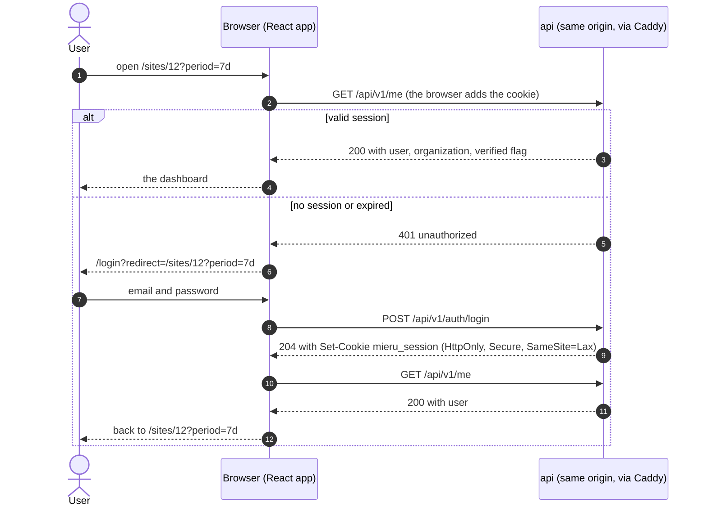

# Mieru: frontend

> The design of the dashboard app: how it is built, served, structured and tested, and the quality bar it must meet. The backend it talks to is in [architecture/](architecture/README.md); folder layout, names and code style are in [conventions.md](conventions.md) sections 1 and 4.

---

## 1. Summary

A **React single-page app built with Vite**, served as static files by Caddy on the same origin as the API. Routing and URL state come from **TanStack Router**, server data from **TanStack Query** over a client typed from the API's OpenAPI schema, UI from **shadcn/ui** (Radix primitives, Tailwind), and charts from **Recharts** through shadcn's chart component.

| Decision | Choice | Main alternative | Why |
|---|---|---|---|
| Rendering | Vite SPA, static files | Next.js | Everything is behind login and live, so server rendering buys nothing. No Node container, the simplest deploy, one build for every environment |
| Router | TanStack Router, file-based | React Router | Typed routes and schema-validated search params. Filters and period live in the URL (D6), so URL parsing must be typed, not hand-written |
| Server state | TanStack Query | Router loaders only | Caching, polling, deduplication and background refresh, all needed by a live dashboard |
| API client | `openapi-typescript` + `openapi-fetch` | Hand-written types; a generated SDK | Types come from the backend's real schema, and CI fails when they drift. A thin `fetch` wrapper, no runtime code generator |
| UI | shadcn/ui on Radix, Tailwind v4 | Mantine | Accessible primitives, components owned in the repo, small bundle, theming by CSS variables |
| Charts | Recharts via shadcn `chart` | uPlot | One time-series chart of at most a few hundred points; fast to build, themed like the rest of the UI. Loaded only on the dashboard route |
| Forms | React Hook Form + Zod | TanStack Form | A handful of forms; the most common pairing, and shadcn's form fields are built for it |

---

## 2. Quality bar

Top bar means measurable targets. Each one is checked in CI or before launch.

**Performance**

| Metric | Target | Checked by |
|---|---|---|
| JS on first load, login page | ≤ 150 KB gzipped | CI size check (`pnpm --dir apps/web size`) |
| JS on first load, dashboard | ≤ 250 KB gzipped, Recharts included | CI size check |
| CSS | ≤ 30 KB gzipped | CI size check |
| LCP, dashboard with data | ≤ 2.0 s at p75 | Lighthouse on the deployed app before launch; real-user data after MVP (section 11) |
| INP | ≤ 100 ms at p75 | as above |
| CLS | ≤ 0.05 | as above; skeletons have fixed sizes |

These are starting budgets. The task that sets up the app measures the real numbers. After that a budget may go down, and it goes up only through a reviewed decision.

**Accessibility:** WCAG 2.2 AA. Every page works with the keyboard alone, at 320 px width, at 200% zoom, with `prefers-reduced-motion` and in both themes. Zero axe violations in the end-to-end tests.

**Reliability:** no blank screens. Every request has a loading, empty and error state (section 8), and a failed panel never takes down the page.

---

## 3. Rendering and deploy

**Build.** `vite build` writes `apps/web/dist/`: `index.html` plus content-hashed files in `dist/assets/`. The build also writes a `.gz` copy of every text file at maximum compression, which Caddy serves directly (`file_server { precompressed gzip }`). Caddy could serve Brotli `.br` copies the same way; they can be added to the build later.

**One build for every environment.** No build-time environment variables. Anything that differs between local and production (the ingest URL shown in the snippet, for example) comes from the API at run time.

**Serving** (Caddy, `mieru.example`)

| Path | Served | Cache |
|---|---|---|
| `/api/*` | proxied to `api` | per response |
| `/assets/*` | static, hashed names | `public, max-age=31536000, immutable` |
| `/theme-init.js`, `/favicon.svg` | static | `public, max-age=3600` |
| anything else | `try_files {path} /index.html` (client-side routes) | `no-cache` on `index.html`, so every load picks up a new deploy |

**Deploy.** CI builds a small `mieru-web` image that only carries `dist/`. `deploy.sh` copies the files out of the image onto the server's disk; no container keeps running:

- The hashed files go into one shared `/opt/mieru/web/assets/` folder. Existing files are never overwritten, and files older than 30 days are deleted.
- `index.html` goes into `/opt/mieru/web/releases/<sha>/`, and a `current` symlink is switched to it in one atomic step.
- Caddy serves `/opt/mieru/web/current` and the shared `assets/` folder from a read-only mount. No reload is needed.

Old assets stay around on purpose: a tab opened before a deploy still loads its old lazy chunks. If a chunk is missing anyway, the app listens for Vite's `vite:preloadError` event and reloads the page once.

**Headers** on the dashboard host (set by Caddy; the rest of the list is in [conventions.md](conventions.md) section 7.5):

```text
Content-Security-Policy: default-src 'self'; script-src 'self'; style-src 'self' 'unsafe-inline';
  img-src 'self' data:; font-src 'self'; connect-src 'self'; object-src 'none'; base-uri 'self';
  form-action 'self'; frame-ancestors 'none'
```

- `script-src 'self'` with no exceptions: the Vite build has no inline scripts, and the theme script (section 7) is a file. Scripts are where the real risk is.
- `style-src` allows `'unsafe-inline'` because shadcn's chart component writes its colour variables into an inline `<style>` element, and positioning libraries set inline styles. Injected CSS is a much smaller risk than injected script.
- Once Mieru tracks its own dashboard (section 11), `script-src` and `connect-src` add `https://in.mieru.example`.

**Browsers:** Vite's default target, the "widely available" web baseline. No polyfills.

**Local development.** `pnpm --dir apps/web dev` starts Vite on port 3000 (the `APP_BASE_URL` in `.env.example`) and proxies `/api` to `localhost:8000`. The browser sees one origin, as it does in production, so cookies and the API's Origin check behave the same.

---

## 4. Routes

File-based routes (`src/routes/`), turned into a typed route tree by the TanStack Router Vite plugin. `autoCodeSplitting` gives each route its own chunk, so the login page never downloads Recharts. Links preload on hover and focus (`defaultPreload: 'intent'`).

| Path | Page | Access | Scope |
|---|---|---|---|
| `/login` | Log in | public | MVP |
| `/register` | Sign up | public | MVP |
| `/verify-email?token=` | Confirms the email, then continues to the app | public | MVP |
| `/` | Redirects to the only site's dashboard, or to `/sites` | logged in | MVP |
| `/sites` | List of sites, with a visitor count for each | logged in | MVP |
| `/sites/new` | Add a site: domain, timezone, then the snippet and the "is it installed?" check | logged in, verified | MVP |
| `/sites/$siteId` | The dashboard | member of the site | MVP |
| `/sites/$siteId/settings` | Domain, timezone, snippet, delete | member of the site | MVP |
| `/settings` | Account: email, password, log out | logged in | MVP |
| `/share/$slug` | Public read-only dashboard | public | after MVP |
| `/settings/billing`, `/settings/notifications`, `/sites/$siteId/goals` | | logged in | after MVP |

A pathless layout route `_app` wraps every logged-in page: it checks the session and renders the app shell (header, site switcher, account menu). Each route sets `document.title`. After a navigation, focus moves to the page's `<h1>` so screen readers announce the new page.

---

## 5. Auth flow

The session is an `HttpOnly` cookie that JavaScript never sees (design: [architecture/api.md](architecture/api.md), "Auth model"). The app only ever asks the API "who am I?".



- **Guard.** `_app`'s `beforeLoad` calls `queryClient.ensureQueryData(meQuery)`. On a 401 it throws `redirect({ to: '/login', search: { redirect: location.href } })`.
- **Redirect target.** It is used only if it starts with `/` and not `//`, so the login page can't become an open redirect.
- **Session ends elsewhere** (logout in another tab, expiry): the API client's middleware sees a 401 on any request, clears the query cache and goes to `/login` with the current page as the redirect.
- **Logout:** `POST /auth/logout`, then `queryClient.clear()`, then `/login`.
- **Unverified users** can use the app but can't add sites. A banner offers to resend the email.
- **Sign-up** always ends on "Check your inbox", whether or not the email already had an account, so emails can't be enumerated.

---

## 6. Data layer

**Types from the API.** `openapi-typescript` generates `src/api/schema.d.ts` from `/api/v1/openapi.json` (`pnpm --dir apps/web api:types`). The file is committed and never edited by hand. CI regenerates it and fails on any difference, so a backend change without an updated client can't merge.

**Client.** `src/api/client.ts` creates one `openapi-fetch` client with base URL `""` (same origin). Its middleware:
- turns any non-2xx response into an `ApiError` (`status`, `code`, `message`, `details`, `requestId` from the `X-Request-Id` header), using the error shape from [conventions.md](conventions.md) section 5;
- handles 401 as described in section 5.

**Queries.** Each feature exports `queryOptions` factories, which are the only way components read server data. They keep keys in one place:

| Data | Query key | Fresh for | Polling |
|---|---|---|---|
| Current user | `['me']` | 5 min | no |
| Sites | `['sites']`, `['sites', siteId]` | 1 min | no |
| Stats | `['stats', siteId, kind, params]` | 30 s, the API's cache time | every 60 s when the period includes today |
| Current visitors | `['realtime', siteId]` | 0 | every 30 s (D4) |
| Install check | `['sites', siteId, 'verify']` | 0 | every 5 s until it turns green, for 10 minutes at most |

**Rules**

- Route loaders call `queryClient.ensureQueryData` for the data a page needs first: the user, the site, and the top stats. Data starts loading in parallel with the route's code, so there is no fetch waterfall after render.
- Stats queries use `placeholderData: keepPreviousData`. When a filter changes, the old numbers stay on screen, dimmed, until the new ones arrive, with no flash of skeletons.
- Polling stops while the tab is hidden (TanStack Query's default) and resumes when it is visible again.
- **Retries:** network errors and 5xx are retried twice with backoff, and `stats_unavailable` (503) up to three times. 4xx errors are never retried.
- After a mutation, the affected keys are invalidated. Optimistic updates are used only where a rollback is trivial.
- Each breakdown panel fetches only its visible tab. A dashboard view costs about six requests: aggregate, timeseries, realtime and the three panels' active tabs.

---

## 7. State

Every piece of state has exactly one home:

| State | Home | Example |
|---|---|---|
| Server data | TanStack Query cache | stats, sites, the current user |
| The view a link should reproduce | URL search params | period, dates, filters, chart metric |
| Local UI | `useState` in the component | an open dialog, the active panel tab |
| User preference | `localStorage` behind a small hook | theme |
| Form input | React Hook Form | login, add site |

There is no global store library. Server data is never copied into `useState` or context. If something seems to need a store, it probably belongs in the URL or the query cache.

**Dashboard search params** (validated by a Zod schema on the `/sites/$siteId` route):

| Param | Values | Default |
|---|---|---|
| `period` | `today`, `yesterday`, `7d`, `30d`, `month`, `12mo`, `custom` | `30d` |
| `from`, `to` | `YYYY-MM-DD`, only with `period=custom` | - |
| `metric` | the stat card driving the chart: `visitors`, `visits`, `pageviews`, `bounce_rate`, `visit_duration` | `visitors` |
| `source`, `utm_source`, `utm_medium`, `utm_campaign`, `page`, `entry_page`, `exit_page`, `country`, `device`, `browser`, `os` | one value each, meaning "equals" | none |

- One plain param per filter keeps URLs readable and shareable: `/sites/12?period=7d&source=Google&country=DE`. One function turns them into the API's `filters` string (`source==Google;country==DE`).
- Default values are stripped from the URL (`stripSearchParams`). Invalid values fall back to the default (`.catch()`), so an edited or old link never crashes the page.
- Dates and hours are shown exactly as the API returns them, already in the site's timezone. The browser's timezone is never used to compute "today" or a bucket.

**Theme.** Light, dark or system. A class on `<html>` holds the theme, and `localStorage` remembers the choice. `public/theme-init.js` is a few lines loaded in `<head>` before the CSS and the app, and sets the class before the first paint (it's a file, not an inline script, because of the CSP).

---

## 8. Components and the dashboard

**Layers**

- `src/components/ui/`: shadcn components, added with the shadcn CLI and owned by the repo. Edited only to change the design system, never for one feature.
- `src/components/`: app-wide components such as `AppShell`, `EmptyState`, `ErrorState` and `ThemeToggle`.
- `src/features/<feature>/`: everything one feature needs: components, query factories, schemas.

**Design tokens.** Colours, radii and chart colours are CSS variables in `src/styles.css`, with light and dark values (Tailwind v4 `@theme`). Components use the tokens, never raw colours. Text uses the system font stack, with no web-font download. Numbers use `tabular-nums`, so digits don't shift as values update.

**Formatting** (`src/lib/format.ts`, all through `Intl`): compact numbers (`12.3k`) with the exact value in the tooltip, percentages, durations (`2m 31s`), country names through `Intl.DisplayNames`, and flags as emoji from the country code. The app never loads images from outside: no favicons of referring sites, because Mieru never fetches URLs that users supply.

**The dashboard**

```text
┌──────────────────────────────────────────────────────────────────────────┐
│ example.com ▾      ● 7 current visitors        [ Last 30 days ▾ ]  ◐  👤 │
├──────────────────────────────────────────────────────────────────────────┤
│ Filters: [ Source is Google × ] [ Country is Germany × ]                 │
├──────────────────────────────────────────────────────────────────────────┤
│ Unique visitors │ Visits │ Pageviews │ Bounce rate │ Visit duration      │
│      1.2k       │  1.5k  │   4.1k    │    41%      │     2m 31s          │
├──────────────────────────────────────────────────────────────────────────┤
│  chart of the selected metric, by hour (ranges up to 2 days) or by day   │
├────────────────────────────────────┬─────────────────────────────────────┤
│ Sources | UTM                      │ Pages | Entry | Exit                │
│ ▇▇▇▇▇▇▇▇▇▇ Google           430    │ ▇▇▇▇▇▇▇▇▇ /pricing            310   │
│ ▇▇▇▇▇ news.ycombinator.com  210    │ ...                   Show more     │
├────────────────────────────────────┼─────────────────────────────────────┤
│ Countries                          │ Devices | Browsers | OS             │
└────────────────────────────────────┴─────────────────────────────────────┘
```

| Component | Behaviour |
|---|---|
| `DateRangePicker` | Preset periods plus a custom range (calendar in a popover). Writes `period`, `from`, `to` |
| `RealtimeBadge` | Current visitors, polled every 30 s. Updates silently, with no live-region announcements every 30 s |
| `FilterBar` | One chip per active filter; removing a chip removes its URL param |
| `StatCards` | The five headline numbers. Clicking a card sets `metric`. Comparison arrows come after the MVP (D8), shown with text as well as colour |
| `VisitorsChart` | Area chart of `metric`. Tooltip with the exact value. "Show as table" switches to a data table with the same numbers. Animation off under `prefers-reduced-motion` |
| `BreakdownPanel` | Tabs, 10 rows with a bar sized by share. Clicking a row adds its filter (D6). "Show more" opens a dialog with paging |
| `InstallCheck` | On a site without data: the snippet with a copy button, and "is it installed?" turning green when the first event arrives (A2) |

**Text from visitors** (page paths, referrers, UTM values) is rendered as text, never as HTML. A link to a referrer opens only `http(s)` URLs, with `rel="noopener noreferrer nofollow"`. `dangerouslySetInnerHTML` is blocked by lint, except inside the shadcn chart file.

---

## 9. Loading, empty and error states

| Situation | What the user sees |
|---|---|
| First load of a page | Skeletons with the final dimensions (no layout shift) |
| Filter or period change | Previous data, dimmed, with a thin progress bar; no skeletons |
| Site has no events yet | The install guide (`InstallCheck`) instead of empty charts |
| Period without visitors | "No visitors in this period" in each panel, with the period named |
| One panel fails | That panel shows the error and a "Retry" button; the rest of the page works |
| `stats_unavailable` (503) | "Stats are busy. Retrying…", then automatic retries |
| 401 | Back to login, then back to the same page and view after logging in |
| Site not found or not yours (404) | A not-found page with a link to `/sites` |
| Form errors (`validation_failed`) | Messages under the fields named in `details`; others at the top of the form |
| 429 | "Too many attempts. Try again in a minute." |
| Network down | "Can't reach Mieru" with "Retry"; polling resumes by itself |
| Anything unexpected | The route's error boundary: a short message, a "Reload" button, and the request id to quote |

Mutations report success or failure with a toast (shadcn's `sonner`), always in addition to the inline state.

---

## 10. Testing

| Layer | Tool | What it covers | Where |
|---|---|---|---|
| Unit | Vitest | Pure logic: the search-param schema (round trips, bad values), filters to the API string, formatting | next to the code, `*.test.ts` |
| Component | Vitest + Testing Library, MSW | Components with behaviour: a row click adds a filter, removing a chip, empty/error states, form validation | next to the code, `*.test.tsx` |
| Contract | CI diff of `schema.d.ts` | The client matches the API | CI |
| End to end | Playwright + `@axe-core/playwright` | User journeys on the real stack with seeded data | `apps/web/e2e/` |
| Size | `pnpm --dir apps/web size` | The budgets in section 2 | CI |

- **Queries by role and name** (`getByRole('button', { name: 'Remove filter: Source is Google' })`). That doubles as an accessibility check. `data-testid` only where nothing accessible exists.
- **The network is mocked at the edge with MSW**, with handlers typed from `schema.d.ts`. Never mock a component's own hooks.
- **End-to-end journeys:**
  - register, verify via the dev email outbox, log in;
  - add a site, see the snippet, send one event to ingest, watch "installed" turn green;
  - open the dashboard, change the period, click a source: every panel filters, the URL changes, and a reload keeps the view;
  - log out.

  Each journey runs axe on every page it visits, in both themes.
- The rules for tests written by agents are in [conventions.md](conventions.md) section 6.8, and they apply here too.

---

## 11. Watching the frontend in production

- **MVP:** errors caught by error boundaries are logged to the browser console with the request id; Lighthouse runs against the deployed app before launch; the size budgets hold in CI.
- **After MVP: Mieru measures itself.** Mieru registers its own dashboard as a site. The app loads `p.js` and sends Core Web Vitals through the `web-vitals` library as a custom event: `mieru('web_vital', {props: {metric: 'LCP', rating: 'good', bucket: '1.5-2s', route: '/sites/$siteId'}})`.
  - Values are bucketed because props are strings, and so the number of distinct values stays small.
  - The route is the pattern, never the real URL with a site id.
  - Breaking events down by property needs custom-property breakdowns (D5), which is why this comes after the MVP.
- **After MVP:** a small `/api/v1/client-errors` endpoint for uncaught errors (message and route only, no user data), rate limited.

---

## 12. Not in the MVP

- Shared public dashboards (D7), goals and conversions (D5), comparison and CSV (D8), billing and notification settings: the routes are reserved in section 4.
- More languages: the UI is English, and formatting already follows the browser's locale through `Intl`. An i18n library comes with the second language.
- Installing as an app, offline mode, push notifications.
- Visual regression tests: considered once the design settles.
