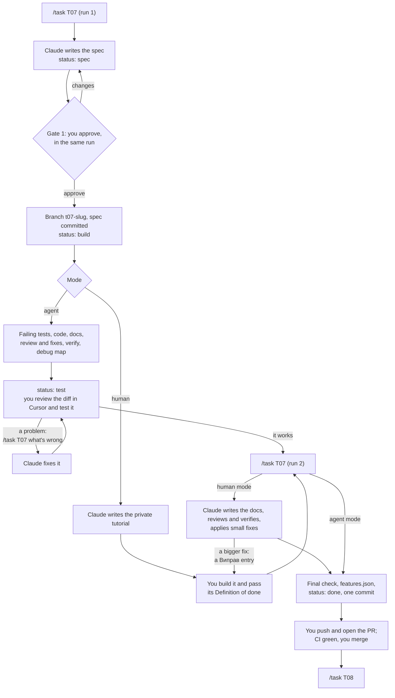

# Mieru: how to work on a task

> Onboarding for anyone who builds Mieru, with or without Claude Code. It covers setting up the machine, finding your way around the docs, and taking a task from the roadmap to a merged PR. The rules the code follows are in [conventions.md](conventions.md), and the task list is in [roadmap.md](roadmap.md).

---

## 1. First day

**Tools**

| Tool | Why | Check |
|---|---|---|
| Git and `gh` (logged in) | Code, branches, PRs | `gh auth status` |
| Docker Desktop | Postgres, Redis and ClickHouse locally | `docker run --rm hello-world` |
| [uv](https://docs.astral.sh/uv/) | Python 3.13 and every backend dependency | `uv --version` |
| pre-commit (`uv tool install pre-commit`) | Format, lint and types before each commit | `pre-commit --version` |
| jq | Used by the Claude Code hooks | `jq --version` |
| Node 24 and pnpm | The web app and the tracker, once they exist | `node --version`, `pnpm --version` |
| Claude Code | Optional, but the `/task` workflow runs in it | `claude --version` |

**Get it running**

```bash
git clone <repository URL> mieru && cd mieru
cp .env.example .env                 # local values; .env is gitignored
pre-commit install                   # runs ruff and mypy on every commit
docker compose up -d                 # Postgres, Redis, ClickHouse
docker compose ps                    # all three "running (healthy)"; ClickHouse takes ~10 s

cd apps/backend
uv sync                              # creates .venv with Python 3.13 and the locked dependencies
uv run ruff check . && uv run mypy src tests
uv run pytest                        # unit and integration tests
```

Then start the two apps, one per terminal, from `apps/backend`:

```bash
uv run uvicorn --factory mieru.api.app:create_app --reload --port 8000
uv run uvicorn --factory mieru.ingest.app:create_app --reload --port 8001
```

- `curl localhost:8000/health/ready` prints `{"postgres":"ok","redis":"ok","clickhouse":"ok"}`.
- `curl localhost:8001/health/ready` prints `{"redis":"ok"}`.

To run them under the debugger instead, use the Cursor configs in `.vscode/launch.json` (section 10).

**With Claude Code:** run `claude` in the repo root. The project's settings, hooks, agents and skills load from `.claude/`. Type `/status` to see where things stand.

---

## 2. Which doc answers what

| Doc | Answers | Read it |
|---|---|---|
| [product.md](product.md) | What Mieru does, for whom, and what "done" means for each feature; what's in the MVP | First, once |
| [architecture/](architecture/README.md) | How the system works and why, one file per topic: write path, privacy, data model, read path, API, tracker, deployment, observability, decisions | Before any backend task, only the files the spec names |
| [frontend.md](frontend.md) | How the React app is built, served and tested | Before any web task |
| [conventions.md](conventions.md) | Layout, names, code style, testing, security and privacy rules. It wins when docs disagree | Skim once; look things up while coding |
| [roadmap.md](roadmap.md) | What's being built now, what's next, every task with its mode and status | Before picking a task |
| [features.json](features.json) | Each feature, the command that proves it, and whether it passes | When a task finishes |
| `docs/tasks/T<NN>-*.md` | One task's contract: scope, criteria, tests, proof of done | The one you're working on |

---

## 3. A task in two runs



**You run `/task` twice per task.**
- **Run 1** writes the spec and asks you to approve it in the same session. While the question waits, you can edit the spec in Cursor.
  - In agent mode, it then builds everything and stops for your test.
  - In human mode, it writes your tutorial and stops.
- **Run 2** means "I tested it and it works". It finishes the checks, fixes what matters, makes the task's one commit, and gives you the push line.
- **A third run** happens only when you report a problem, or a review finding needs you to type the fix.

**Statuses** are kept in the spec's frontmatter and in its roadmap row:

| Status | Meaning | Your move |
|---|---|---|
| `todo` | Not started | `/task <ID>` |
| `spec` | The spec waits for your approval (gate 1) | Answer the question. If the session ended, `/task <ID>` asks again |
| `build` | Agent mode: Claude is building. Human mode: you're following the tutorial | Agent: wait (`/task <ID>` resumes an interrupted build). Human: `/task <ID>` once the tutorial's Definition of done passes |
| `test` | Agent mode: built, reviewed and verified; it waits for your test | `/task <ID>` if it works, `/task <ID> <what's wrong>` if not |
| `done` | Set in the task's commit; true once merged | Push, open the PR, merge, then `/task <next>` |

Each run picks up from the status, so it's safe to stop and come back the next day.

---

## 4. Commands

| Command | What it does |
|---|---|
| `/status` | Reads the roadmap, git state and open PRs, and runs the fast checks. It changes nothing, and gives 15 lines: what's in progress, what each task waits on, and what to run next |
| `/task <ID>` | Run 1: the spec, your approval, then the build (agent) or the tutorial (human). Run 2: the checks, the fixes, the one commit and the push line |
| `/task <ID> <feedback>` | Run 2 with feedback: a problem from your test, a request ("apply nit 2"), or output a `human:` criterion needs |
| `/task <ID> --human` / `--agent` | Overrides the mode. Works only before the build starts |
| `/verify <ID>` | Runs the proof-of-done checks in a separate read-only agent. Gives `VERDICT: DONE / FAIL / NEED_HUMAN` with evidence per criterion |
| `/commit [hint]` | For work outside a task. Commits the changes you reviewed as one conventional commit, with a message written from the diff, and writes the PR description to `.git/pr-<ID>.md`. Until the push, a later run amends that commit, so the branch stays at one. Never pushes. `/task` follows the same procedure for its one commit |
| `/code-review` | Claude Code's built-in bug-focused review of the current diff. An optional second opinion next to the spec-aware reviewer |
| `! <command>` | Runs a shell command yourself, inside the session. Used for `git push`, which Claude is not allowed to run |

**Behind the commands** (all in `.claude/`, all public):

| Part | Role |
|---|---|
| `skills/task/` | The `/task` procedure, the spec template, and the private human-mode tutorial template |
| `skills/commit/` | Committing: one commit per run, message rules, what never gets committed, the PR description |
| `agents/test-writer.md` | Writes the failing tests from the spec; never touches the implementation |
| `agents/reviewer.md` | Reviews the changes against the spec in a fresh context; can't edit files |
| `agents/verifier.md` | Runs every check and gives the verdict; can't edit files |
| `hooks/protect.sh` | Blocks reading secrets and destructive commands, whatever a prompt says |
| `hooks/format.sh` | Formats every file Claude writes |
| `settings.json` | Permissions: what runs without asking, and what is never allowed (push, ssh, `rm -rf`, `.env`) |

---

## 5. Agent mode or human mode

| | Agent mode (default) | Human mode |
|---|---|---|
| Who writes the code | Claude, test-first, inside the spec's allowed files | You, from a step-by-step tutorial with copy-paste code and explanations |
| Who writes the docs | Claude | Claude, in run 2, from your code |
| Review fixes | Claude applies must-fix and should-fix findings before your test | Claude applies the small ones in run 2 and explains each one in a "Виправ" entry; bigger ones come back to you |
| What you get besides the spec | The build, ready to test, with a debug map | A private tutorial in `docs/learn/` (gitignored), with "try it yourself" blocks, experiments, questions and talking points |
| Your time | Approve, then test | One or two evenings |
| Pick it for | Glue, CRUD, React, ops automation, anything you already know | The parts you must be able to explain and defend: the pipeline, the data model, auth, infrastructure |

Each task's default mode is in the roadmap. The tag is a starting point, not a rule: override it when you want.

---

## 6. Approving a spec (gate 1)

Approve only when every line holds:

- [ ] **Goal:** it says what works afterwards and for whom, in a sentence or two.
- [ ] **Scope:** "In" and "Out" are clear, and "Out" names the task that does the rest.
- [ ] **Allowed files:** specific, docs included, and nothing surprising without a reason (a migration, a shared fixture, CI config).
- [ ] **Interfaces:** the names match [conventions.md](conventions.md) section 5, and new names are worth keeping.
- [ ] **Criteria:** each one is observable, and ends with an `auto:` command that would fail if the criterion were broken, or with `human:` steps.
- [ ] **Proof of done:** it proves the criteria, not just "the tests pass".
- [ ] **Test it yourself:** you could do it in five minutes.
- [ ] **Decisions:** nothing contradicts the architecture or the conventions. A spec that changes a decision says so, and the decision gets updated in the same PR.
- [ ] **Size:** an agent task fits in about 300 changed lines, a human task in one or two evenings. Otherwise, split it.

While the approval question waits, edit the spec file in Cursor, or type your changes through "Other". Then approve.

---

## 7. What the agents check

**The reviewer** reads the changes in a fresh context, against the spec and the conventions. Its checklist and severities are in [`reviewer.md`](../.claude/agents/reviewer.md).
- **must-fix:** wrong behaviour, a privacy, security or tenant problem, a weakened test, or an unmet criterion. Always fixed.
- **should-fix:** a real risk, worth fixing before the merge. Fixed as well.
- **nit:** small and optional. Listed, and applied only when you ask: `/task <ID> apply nit 2`.

**The verifier** runs the standard checks, every `auto:` command, the proof of done and the feature checks. It also checks the scope (only the allowed files changed) and test integrity (nothing deleted, skipped or loosened). It can't edit files, so it can't make a check pass. The details are in [`verifier.md`](../.claude/agents/verifier.md).
- **DONE:** every criterion is proven, and the `human:` ones are confirmed (running `/task` in run 2 confirms them).
- **FAIL:** something failed. Claude fixes it and verifies again, at most three times, then stops and shows you the report.
- **NEED_HUMAN:** nothing failed, but something needs a person: `human:` steps, a check that runs only on the server, or a criterion too vague to check.

**After three FAILs in a row,** read the report's "To reach DONE" list. The usual causes are:
- the services are down;
- a command in the spec is wrong (Claude fixes the spec and notes the change);
- a test is flaky.

You can also take the task over yourself.

The spec's Review section records every verdict and finding, and what was done about each, so the PR tells the whole story.

**What you still check yourself:**
- Read the whole diff.
- Make sure you can explain every function in it.
- Make sure the tests would fail if the feature were removed.
- Look for anything that touches IPs, user agents or logs.
- Ask about anything that surprises you.

The rules that never bend are in [CLAUDE.md](../CLAUDE.md) and in conventions sections 6.8 and 7. The agents catch a lot, but they don't own the code; you do.

---

## 8. Git

- **Branch:** `t<nn>-<slug>`, made from an up-to-date `main` when you approve the spec.
- **Two commits per task.** The spec is committed when you approve it. The build becomes one commit in run 2: tests, code, docs and status. Nothing is committed in between.
  - In agent mode you review the build as uncommitted changes in Cursor before you test it.
  - In human mode you look over the commit before you push.
- **Undoing:**
  - Before the push, a change is amended into the task commit; just ask Claude.
  - To throw the build away before the push: `git reset --hard HEAD~1` (`--soft` keeps the files).
  - After the push, a fix is a new commit. After the merge: `git revert -m 1 <merge commit>`.
- **Commits** are conventional (`feat(ingest): ...`, `fix(writer): ...`, `docs(tasks): ...`). Every commit passes the checks, and pre-commit runs ruff and mypy.
- **Push and PR:** Claude never pushes. Run 2 writes the PR description to `.git/pr-<ID>.md`, and gives you one line to run in the session:

  ```text
  ! git push -u origin t07-slug && gh pr create --draft --title "feat(ingest): ..." --body-file .git/pr-T07.md
  ```

- **CI is the gate on GitHub:** lint, types and tests against real databases. When it's green, mark the PR ready and merge it yourself.
- **After the merge,** run `/task <next>`. It switches to `main` and pulls by itself.
- **Work outside a task** stays uncommitted until you run `/commit`. The branch gets one commit, and until the push a later `/commit` amends it.
- **Size:** one task is one PR, under about 600 changed lines. Agent PRs stay under about 300.

---

## 9. Without Claude Code

Nothing here depends on Claude Code. The spec is the contract, and the commands in it are ordinary shell commands.

1. Pick the first `todo` task in [roadmap.md](roadmap.md) whose dependencies are `done`.
2. Write its spec from `.claude/skills/task/spec-template.md`, or ask for one, and get it approved in a PR or a review.
3. Branch, write the tests for each `auto:` criterion, and watch them fail.
4. Implement inside the allowed files, docs included.
5. Run the standard checks, every `auto:` command and every proof-of-done command. `.claude/agents/verifier.md` is the full checklist, and it works for people too.
6. Update the status in the spec's frontmatter and in the roadmap row. When the task is done, also update the Now block's Next. Flip `features.json` only for checks that ran green. Open the PR from the template.

---

## 10. Debugging

Every spec has a "Where to debug" table, written before you test. It lists three to five places where the task's behaviour is decided, each with a `file:line`, a trigger that reaches it, and what to look at. Start there.

**In Cursor.** `.vscode/launch.json` holds four configs.
1. Select the interpreter `apps/backend/.venv/bin/python` once (Command Palette, "Python: Select Interpreter").
2. Click left of a line number to set a breakpoint.
3. Start a config from the Run and Debug panel:

| Config | Runs | Reach your breakpoint with |
|---|---|---|
| `api` | the api on port 8000 | `curl` or the browser |
| `ingest` | ingest on port 8001 | `curl` |
| `pytest: current file` | the tests in the open file | the tests themselves |
| `pytest: -k` | the tests matching an expression it asks for | the tests themselves |

Some details of these configs:
- **No `--reload`.** The app configs run without it, because reload runs the app in a child process and the debugger stays attached to the parent. Restart the config after a change.
- **One process per port.** Stop any `uvicorn` already running on the same port first.
- **`envFile` points at a file that doesn't exist.** This stops Cursor from loading `.env` itself. Cursor's parser would keep the inline `# comments` as part of the values, and those environment variables would override the app's own reading of `.env`.

**In the terminal**, from `apps/backend`:
- **`breakpoint()`** on a line stops there and opens [pdb](https://docs.python.org/3/library/pdb.html#debugger-commands): `p <expr>` prints a value, `n` runs the next line, `s` steps into a call, `c` continues, `q` quits. Remove it before committing. See [`breakpoint()`](https://docs.python.org/3/library/functions.html#breakpoint).
- **`uv run pytest <path> -k <name> --pdb`** opens pdb where a test fails, with its variables in scope. See [`--pdb`](https://docs.pytest.org/en/stable/how-to/failures.html#using-python-library-pdb-with-pytest).
- **`-s`** shows `print` output, and **`--lf`** reruns only the tests that failed last time.

**Logs.** Every response carries an `X-Request-Id` header (`curl -i` shows it), and every log line of that request carries the same `request_id`. Search the app's terminal for it. Locally the logs are readable lines; in the other environments they are JSON.

---

## 11. Troubleshooting

| Symptom | Cause and fix |
|---|---|
| `Blocked by .claude/hooks/protect.sh: <reason>` | The hook stopped a command that reads secrets or destroys data. It reads the whole command, so a commit message or a search that mentions `.env` or `DROP TABLE` trips it too. For a commit message, write it to a file under `.git/` and use `git commit -F <file>`. Otherwise rephrase, or run it yourself with `! <command>` |
| `Cannot connect to the Docker daemon` | Docker Desktop isn't running. Start it, then `docker compose up -d` |
| Postgres port 5432 already in use | A local Postgres (often Homebrew) is running. Find it with `brew services list` and stop it, e.g. `brew services stop postgresql@18` |
| Port 8000, 8001 or 3000 in use | Another dev server is still running: `lsof -i :8000`, then stop that process |
| Integration tests can't connect right after `docker compose up -d` | The services are still starting. Wait until `docker compose ps` shows "healthy" |
| `/task` stopped after three FAILs | See section 7: read "To reach DONE", fix the cause, then run `/task <ID>` again |
| `/task` says the working tree isn't clean | Run 1 starts from a clean `main`. Commit (`/commit`) or stash the unrelated changes first |
| `/task`, `/verify` or `/status` is unknown | Claude Code reads `.claude/` at start. Restart it after pulling changes to `.claude/` |
| `uv.lock` changed unexpectedly | Something ran `uv sync` or `uv add`. Check with `git diff apps/backend/uv.lock`, and restore it if the change wasn't intended |
| pre-commit isn't running on commit | `pre-commit install` in the repo root |
