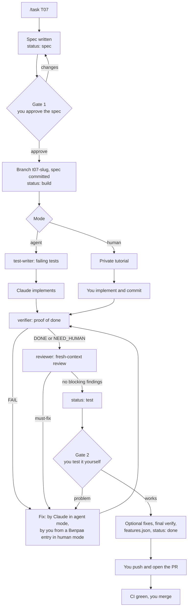

# Mieru: how to work on a task

> Onboarding for anyone who builds Mieru, with or without Claude Code: set up the machine, find your way around the docs, and take a task from the roadmap to a merged PR. The rules the code follows are in [conventions.md](conventions.md); the task list is in [roadmap.md](roadmap.md).

---

## 1. First day

**Tools**

| Tool | Why | Check |
|---|---|---|
| Git and `gh` (logged in) | Code, branches, PRs | `gh auth status` |
| Docker Desktop | Postgres, Redis and ClickHouse locally | `docker run --rm hello-world` |
| [uv](https://docs.astral.sh/uv/) | Python 3.13 and every backend dependency | `uv --version` |
| pre-commit (`uv tool install pre-commit`) | Format, lint and types before each commit | `pre-commit --version` |
| jq | Used by the Claude Code hooks | `jq --version` |
| Node 24 and pnpm | The web app and the tracker, once they exist | `node --version`, `pnpm --version` |
| Claude Code | Optional, but the `/task` workflow runs in it | `claude --version` |

**Get it running**

```bash
git clone <repository URL> mieru && cd mieru
cp .env.example .env                 # local values; .env is gitignored
pre-commit install                   # runs ruff and mypy on every commit
docker compose up -d                 # Postgres, Redis, ClickHouse
docker compose ps                    # all three "running (healthy)"; ClickHouse takes ~10 s

cd apps/backend
uv sync                              # creates .venv with Python 3.13 and the locked dependencies
uv run ruff check . && uv run mypy src
uv run pytest                        # unit and integration tests
```

Then start the two apps, one per terminal, from `apps/backend`:

```bash
uv run uvicorn --factory mieru.api.app:create_app --reload --port 8000
uv run uvicorn --factory mieru.ingest.app:create_app --reload --port 8001
```

- `curl localhost:8000/health/ready` prints `{"postgres":"ok","redis":"ok","clickhouse":"ok"}`.
- `curl localhost:8001/health/ready` prints `{"redis":"ok"}`.

**With Claude Code:** run `claude` in the repo root. The project's settings, hooks, agents and skills load from `.claude/`. Type `/status` to see where things stand.

---

## 2. Which doc answers what

| Doc | Answers | Read it |
|---|---|---|
| [product.md](product.md) | What Mieru does, for whom, and what "done" means for each feature; what's in the MVP | First, once |
| [architecture.md](architecture.md) | How the system works and why: components, data flow, data model, deployment, trade-offs | Before any backend task, the sections the spec names |
| [frontend.md](frontend.md) | How the React app is built, served and tested | Before any web task |
| [conventions.md](conventions.md) | Layout, names, code style, testing, security and privacy rules. It wins when docs disagree | Skim once; look things up while coding |
| [roadmap.md](roadmap.md) | What's being built now, what's next, every task with its mode and status | Before picking a task |
| [features.json](features.json) | Each feature, the command that proves it, and whether it passes | When a task finishes |
| `docs/tasks/T<NN>-*.md` | One task's contract: scope, criteria, tests, proof of done | The one you're working on |

---

## 3. A task's life



**Statuses**, kept in the spec's frontmatter and mirrored in the roadmap:

| Status | Meaning | Your move |
|---|---|---|
| `todo` | Not started | `/task <ID>` |
| `spec` | The spec waits for you (gate 1) | Read it, edit it or ask for changes, then `/task <ID>` and approve |
| `build` | Being built: by Claude (agent) or by you from the tutorial (human) | Agent: wait. Human: follow the tutorial, then `/task <ID>` |
| `test` | Verified and reviewed; waits for your test (gate 2) | Follow "Test it yourself", then `/task <ID>` |
| `done` | Set in the PR's last commit; true once merged | Push, open the PR, merge, then `/task <ID>` to close |

Everything between the two gates runs without you in agent mode. Each run of `/task <ID>` picks up from the status, so it's safe to stop and come back the next day.

---

## 4. Commands

| Command | What it does | What you get |
|---|---|---|
| `/status` | Reads the roadmap's "Now" block, git state, open PRs, and runs the fast checks. Changes nothing | 15 lines: where things stand and what to run next |
| `/task <ID>` | Moves the task one stage forward from its status (section 3) | The spec, a build report at gate 2, or the push command at the end |
| `/task <ID> --human` / `--agent` | Same, with the mode overridden. Only before the build starts | |
| `/verify <ID>` | Runs the proof-of-done check in a separate read-only agent | `VERDICT: DONE / FAIL / NEED_HUMAN` with evidence per criterion |
| `/code-review` | Claude Code's built-in bug-focused review of the current diff | Findings; an optional second opinion next to the spec-aware reviewer |
| `! <command>` | Runs a shell command yourself, inside the session | Used for `git push`, which Claude is not allowed to run |

**Behind the commands** (all in `.claude/`, all public):

| Part | Role |
|---|---|
| `skills/task/` | The `/task` procedure, the spec template, and the private human-mode tutorial template |
| `agents/test-writer.md` | Writes the failing tests from the spec; never touches implementation |
| `agents/verifier.md` | Runs every check and gives the verdict; can't edit files |
| `agents/reviewer.md` | Reviews the diff against the spec in a fresh context; can't edit files |
| `hooks/protect.sh` | Blocks reading secrets and destructive commands, whatever a prompt says |
| `hooks/format.sh` | Formats every file Claude writes |
| `settings.json` | Permissions: what runs without asking, and what is never allowed (push, ssh, `rm -rf`, `.env`) |

---

## 5. Agent mode or human mode

| | Agent mode (default) | Human mode |
|---|---|---|
| Who writes the code | Claude, test-first, inside the spec's allowed files | You, from a step-by-step tutorial with copy-paste code and explanations |
| What you get besides the spec | A build report at gate 2 | A private tutorial in `docs/learn/` (gitignored) with "try it yourself" blocks, experiments, explain-it-back questions and talking points |
| Your time | Two short gates | One or two evenings |
| Pick it for | Glue, CRUD, React, ops automation, anything you already know | The parts you must be able to explain and defend: the pipeline, the data model, auth, infrastructure |

Each task's default mode is in the roadmap. Override it when you want: the tag is a starting point, not a rule.

---

## 6. Approving a spec (gate 1)

Approve only when every line holds:

- [ ] **Goal:** it says what works afterwards and for whom, in a sentence or two.
- [ ] **Scope:** "In" and "Out" are clear, and "Out" names the task that does the rest.
- [ ] **Allowed files:** specific, and nothing surprising (a migration, a shared fixture, CI config) without a reason.
- [ ] **Interfaces:** the names match [conventions.md](conventions.md) section 5, and new names are worth keeping.
- [ ] **Criteria:** each one is observable, and ends with an `auto:` command that would fail if the criterion were broken, or `human:` steps.
- [ ] **Proof of done:** the commands prove the criteria, not just "the tests pass".
- [ ] **Test it yourself:** you could do it in five minutes.
- [ ] **Decisions:** nothing contradicts the architecture or the conventions. A spec that changes a decision says so, and the decision gets updated in the same PR.
- [ ] **Size:** agent tasks fit in about 300 changed lines, human tasks in one or two evenings. Otherwise split it.

Edit the spec file directly, or tell Claude what to change. Then run `/task <ID>` again and approve.

---

## 7. Proof of done

The verifier runs every `auto:` command and every proof-of-done command, plus the feature checks and two mechanical checks: scope (only allowed files changed) and test integrity (nothing deleted, skipped or loosened). It can't edit files, so it can't make a check pass.

| Verdict | Meaning | What happens |
|---|---|---|
| **DONE** | Every criterion is proven, and the `human:` ones are confirmed by you | The task can finish |
| **FAIL** | A command failed, a criterion isn't met, a file outside the scope changed, or a test was weakened | Agent mode: Claude fixes and verifies again, at most three times, then stops and shows you the report. Human mode: each problem becomes a "Виправ" entry in your tutorial |
| **NEED_HUMAN** | Nothing failed, but something needs a person: `human:` steps, a check that runs only on the server, or a criterion too vague to check | Usual at gate 2: your test supplies the missing confirmation |

**At gate 2:** follow the spec's "Test it yourself" steps against the real app, not just the tests. Then run `/task <ID>` and answer the question. "No, I found a problem" sends the task back to build with your description. "Yes, it works" leads to the optional fixes, a final verification, and the `features.json` update.

**After three FAILs in a row,** read the report's "To reach DONE" list. The usual causes:
- the services are down;
- a command in the spec is wrong: fix the spec and note the change in its Notes;
- a test is flaky.

You can also take over the task yourself.

---

## 8. Review

The reviewer reads the diff in a fresh context, against the spec and the conventions, and sorts what it finds:

| Severity | Meaning | Handling |
|---|---|---|
| **must-fix** | Wrong behaviour, a privacy, security or tenant problem, a weakened test, an unmet criterion | Always fixed before gate 2 |
| **should-fix** | A real risk or a maintenance cost, but not blocking | Offered at gate 2; you choose |
| **nit** | Small and optional | Offered at gate 2; you choose |

The spec's Review section records every finding and what was done with it, so the PR tells the whole story.

**What you still check yourself:**
- Read the whole diff.
- Make sure you can explain every function in it.
- Make sure the tests would fail if the feature were removed.
- Look for anything that touches IPs, user agents or logs.
- Ask about anything that surprises you.

The agents catch a lot. They are not the owner of the code; you are.

---

## 9. Git

- **Branch:** `t<nn>-<slug>` from an up-to-date `main`, created by `/task` at gate 1. The first commit is the spec.
- **Commits:** conventional (`feat(ingest): ...`, `fix(writer): ...`, `test(stats): ...`, `docs(tasks): ...`). Every commit passes the checks; pre-commit runs ruff and mypy.
- **Push and PR:** Claude never pushes. At the end, `/task` writes the PR description to `.git/pr-<ID>.md` and gives you one line to run in the session:

  ```text
  ! git push -u origin t07-slug && gh pr create --draft --title "feat(ingest): ..." --body-file .git/pr-T07.md
  ```

- **CI is the gate on GitHub:** lint, types and tests against real databases. Mark the PR ready when it's green, then merge it yourself.
- **After the merge:** run `/task <ID>` (it confirms the merge and names the next task), then `git switch main && git pull`.
- **Size:** one task is one PR, under about 600 changed lines; agent PRs under about 300.

---

## 10. Rules that never bend

- **Tests are never deleted, skipped or weakened** to make a change pass. If a test is wrong, say so and stop.
- **Privacy:** no IP address, user agent or request body in logs or storage. The raw IP never leaves `mieru.ingest`.
- **Tenant scope:** every query on tenant data is scoped by `org_id` or `site_id`. A site you can't access is a 404.
- **Secrets** live only in `.env` files. They never go into git, logs, specs, screenshots or a Claude session. If one leaks, rotate it first.
- **`features.json`** flips to `true` only after the feature's check ran green.
- **Public files never link to private ones** (`docs/learn/`, `CLAUDE.local.md`).

---

## 11. Without Claude Code

Nothing here depends on Claude Code. The spec is the contract, and the commands in it are ordinary shell commands.

1. Pick the first `todo` task in [roadmap.md](roadmap.md) whose dependencies are `done`.
2. Write its spec from `.claude/skills/task/spec-template.md`, or ask for one, and get it approved in a PR or a review.
3. Branch, write the tests for each `auto:` criterion, and watch them fail.
4. Implement inside the allowed files.
5. Run every `auto:` command and every proof-of-done command. `.claude/agents/verifier.md` is the full checklist, and it works for people too.
6. Update the status in three places: the spec's frontmatter, the roadmap row, and the "Now" block. Flip `features.json` for checks that ran green. Open the PR from the template.

---

## 12. Troubleshooting

| Symptom | Cause and fix |
|---|---|
| `Blocked by .claude/hooks/protect.sh: <reason>` | The hook stopped a command that reads secrets or destroys data. It reads the whole command, so a commit message or a search that mentions `.env` or `DROP TABLE` trips it too. For a commit message, write it to a file under `.git/` and use `git commit -F <file>`. Otherwise rephrase, or run it yourself with `! <command>` |
| `Cannot connect to the Docker daemon` | Docker Desktop isn't running. Start it, then `docker compose up -d` |
| Postgres port 5432 already in use | A local Postgres (often Homebrew) is running. Find it with `brew services list` and stop it, e.g. `brew services stop postgresql@18` |
| Port 8000, 8001 or 3000 in use | Another dev server is still running: `lsof -i :8000`, then stop that process |
| Integration tests can't connect right after `docker compose up -d` | The services are still starting. Wait until `docker compose ps` shows "healthy" |
| `/task` stopped after three FAILs | See section 7: read "To reach DONE", fix the cause, run `/task <ID>` again |
| `/task` says the working tree isn't clean | Commit or stash unrelated changes first; the build starts from a clean `main` |
| `/task`, `/verify` or `/status` is unknown | Claude Code reads `.claude/` at start. Restart it after pulling changes to `.claude/` |
| `uv.lock` changed unexpectedly | Something ran `uv sync` or `uv add`. Check with `git diff apps/backend/uv.lock`; restore it if the change wasn't intended |
| pre-commit isn't running on commit | `pre-commit install` in the repo root |
